# Ride classifier: MLOps on a ride's motion sensors

From the motion sensors of a ride (accelerations and rotations at 10 Hz), our system tells **which of 5 riding
categories** it belongs to: Safe, Safe overall, Bad weather, Tandem or Reckless. A second model scores the **risk of
a fall** over the last 10 seconds. Both are trained in a versioned pipeline, tracked in MLflow, served by an API and a
web app, and released to a Kubernetes cluster by GitHub Actions after a human approval, with automatic rollback.

**Docker Hub:** [alexwaer110302/ride-api](https://hub.docker.com/r/alexwaer110302/ride-api) ·
[alexwaer110302/ride-webapp](https://hub.docker.com/r/alexwaer110302/ride-webapp) (code only: the models are loaded
from MLflow at startup, see [Technical choices](#technical-choices)).

**Documentation:** [usage guide](docs/how_to_use.md) (every command) · [plan and decisions](docs/PLAN.md) ·
[decision records](docs/decisions/README.md) · [project framing](docs/PROJECT_FRAMING.md) ·
[runbooks](docs/runbooks.md).

---

## What the project covers

| Guidelines | What we built | Where |
|---|---|---|
| 1. Extract the data | GBG500 (500 rides, 5 labels) and SRV3490 (3,490 rides with falls), versioned with DVC; remotes: S3 per laptop, shared bucket on GCP | `data/raw/*.dvc`, `dvc.yaml` |
| 2. Deep learning classifier, 5 categories, better than random | 1D CNN (PyTorch) on 30 s windows: golden macro-F1 **0.511** vs **0.20** for random guessing | `src/ride_classifier/models/cnn.py` |
| 3. Model stored on S3 (MinIO) | MLflow stores every model and file in S3-compatible storage (SeaweedFS), in dev and in the cluster | `docker-compose.yml`, `k8s/storage/` |
| 4. Track models and experiments with MLflow | Every run records params, metrics, data fingerprints, git commit and quality gate; registry with `@staging` / `@production` aliases and registration rules | `src/ride_classifier/registry/` |
| 5. API | FastAPI with Swagger (`/docs`): whole ride, file upload, live window by window, `/health`, `/metrics` | `src/ride_classifier/api/` |
| Interactive web app | Streamlit: pick or upload a ride, see its signals, get the category, probabilities and Reckless flag | `webapp/` |
| 6. Docker + Kubernetes, deployed by GitHub Actions (self-hosted runner) | Code-only images on Docker Hub; kind cluster (API ×2 + canary, web app, MLflow, Postgres, S3); `cd.yml`: build → approval → release on the self-hosted runner → automatic rollback | `docker/`, `k8s/`, `.github/workflows/cd.yml` |
| 7. Version and document on GitHub | Work on branches, pull requests merged with CI green, conventional commits, docs per topic | [PRs](https://github.com/Xenodion/mlops-and-model-deployment-navy/pulls?q=is%3Apr), `docs/` |
| Pipeline / workflow DAG | DVC pipeline: `uv run dvc dag` | `dvc.yaml` |
| Tests | 189 unit and integration tests; container smoke test in CI, in CD before pushing, and on the cluster after each release | `tests/` |
| Dev environment with Docker Compose | S3, Postgres, MLflow; API and web app (`app` profile); Prometheus and Grafana (`monitoring` profile) | `docker-compose.yml` |
| Bonus: retraining pipeline | `train.yml`: scheduled or manual training on the self-hosted runner, quality gate, registered as `@staging`. Promotion stays human (`make promote`, then `make k8s-model`) | `.github/workflows/train.yml` |
| Bonus: monitoring | Prometheus + Grafana dashboard (requests, latency, predictions, input drift), drift exporter, daily drift report (`drift.yml`), on compose and on kind | `monitoring/`, `k8s/monitoring/` |
| Bonus: feature store | Local Feature Store: offline Parquet + SQLite online lookup (`ride_stats`, `window_drift_stats`) | `src/ride_classifier/features/store.py` |

---

## Architecture

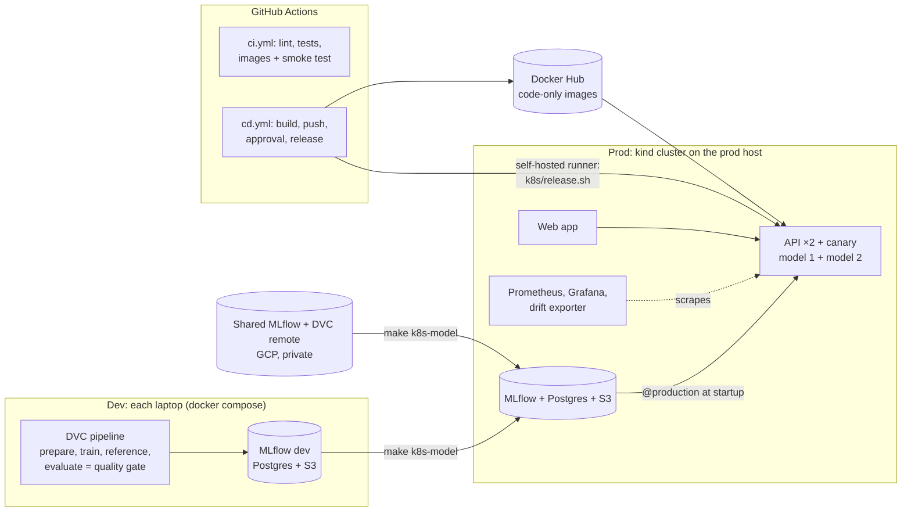

- **Dev:** each teammate runs the stack with `make dev-up`; the shared MLflow on GCP lets the team see each other's
  runs and holds the registered models.
- **Prod:** a kind cluster on one laptop (the "prod host"), reached at http://127.0.0.1:8080 (API), :8081 (web app),
  :8082 (MLflow), :8083 (Grafana), :8084 (Prometheus).
- **Release of code:** merge into `main` → `cd.yml` builds and pushes the images → a reviewer approves → the
  self-hosted runner releases them, runs the smoke test on the cluster, rolls back if anything fails, and the bot
  commits the released tag to `k8s/kustomization.yaml`.
- **Release of a model:** the images carry no model. Training registers `@staging`; a human promotes it to
  `@production` (`make promote`), then `make k8s-model` copies it into the cluster's MLflow and restarts the API.

---

## Results

### Model 1: ride type (the 5 categories of the brief)

Evaluated once on **100 golden rides** frozen before any training (stratified, never used to choose anything), after
5-fold cross-validation on the 400 others. Quality gate: golden macro-F1 ≥ 0.30 and above both references.

| Experiment | CV macro-F1 | Golden macro-F1 | Gate |
|---|---|---|---|
| References: random guessing / always "Safe" | 0.20 / 0.18 | 0.20 / 0.18 | |
| E0 baseline: ~170 statistics per ride + logistic regression (v1) | 0.373 ± 0.062 | 0.477 | passed |
| E1 CNN, balanced class weights, 20 epochs | 0.282 | 0.177 | failed |
| E2 CNN, square-root class weights, 20 epochs | 0.312 | 0.286 | failed |
| **E3 CNN, square-root class weights, 10 epochs (v2, in production)** | **0.357 ± 0.071** | **0.511** | **passed** |

- **E3 is in production to meet the brief's deep learning requirement**, not because it is better: it is tied with
  the baseline within the noise (CV favours the baseline, golden the CNN). The baseline stays registered as v1.
- Golden recall per category: Safe 0.75, Safe overall 0.63, Bad weather 0.00, Tandem 0.75, Reckless 1.00. The golden
  set holds **a single Reckless ride**, so that last number cannot establish detection reliability; the data has 6
  Reckless rides in total.
- E3 was retrained from a clean commit and reproduced exactly; every score is in MLflow with its commit and data md5.

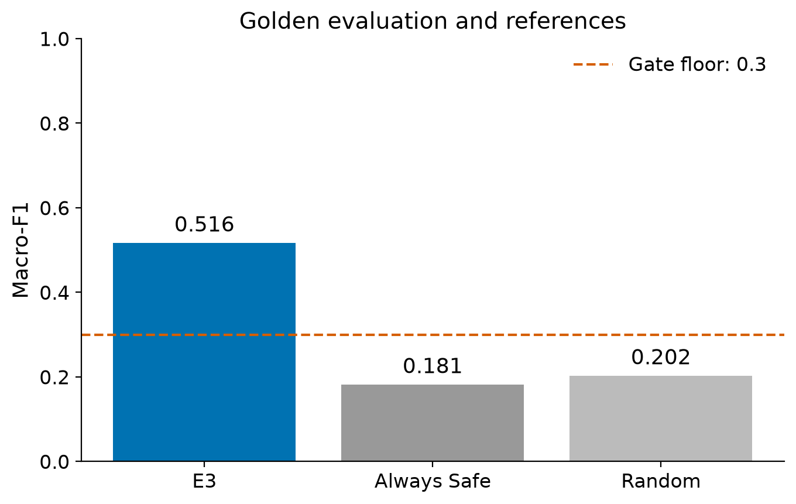
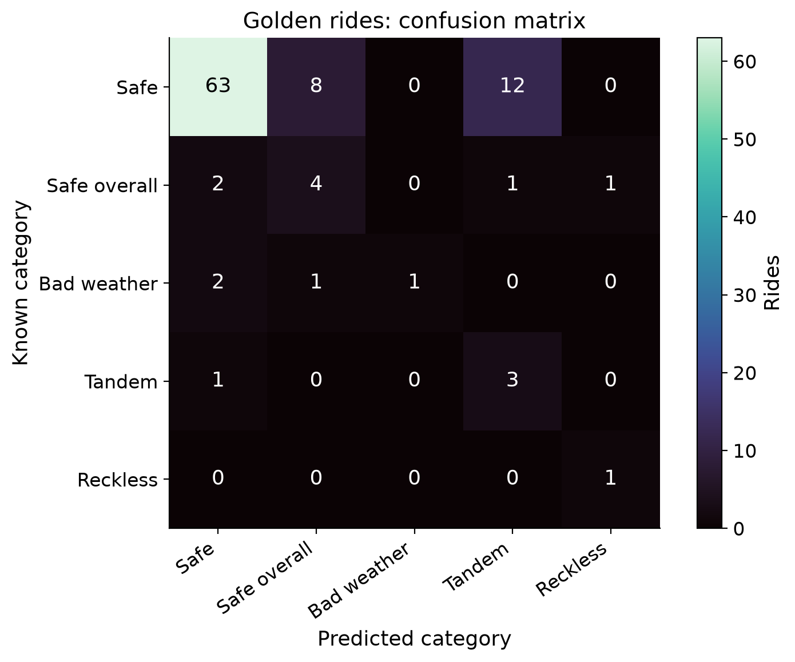

### Model 2: fall risk (SRV3490, a bonus that uses the rest of the data)

A logistic regression on statistics of 10 s windows scores how abnormal the last 10 seconds are. It is trained on the
minute before each fall vs the same moments of comparison rides, never sees the last 5 s before a fall (anti-leakage
gap), and is evaluated on held-out groups of rides.

| Held-out (registered `fall-risk` v1) | 5 s gap | 10 s gap (sanity check) |
|---|---|---|
| Paired AUC (fall ride vs its comparison rides) | **0.888** | 0.756 |
| Window AUC | 0.712 | 0.691 |

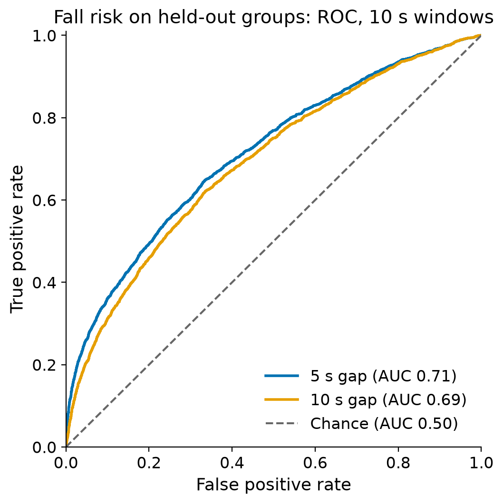

### Production (measured on the kind cluster, 24/11)

| What | Measured |
|---|---|
| Live endpoint `/v1/predict/window` (one 30 s window, both models), 50 calls | median **128 ms**, p95 **184 ms**: within the 200 ms latency budget |
| Whole ride `/v1/predict` (both models, full timeline), 30 calls | 4.0 min ride: median 2.0 s · 7.5 min ride: median 3.7 s (1 CPU per pod) |
| CD release (`cd.yml`) | images built, smoke-tested and pushed in 3 min; release with smoke test in 4 min after approval |
| Failed release (image tag that doesn't exist) | rolled back by itself; **the API answered 200 to every check** during the attempt (30 checks over 2 min) |
| Cluster memory, everything running (API ×2, web app, MLflow, Postgres, S3, Prometheus, Grafana, exporter) | 3.8 GB |

### Production screenshots

**The web app (:8081), a golden Reckless ride classified by both models**, then both along the ride on one time
axis: each category's probability so far, model 1's answer so far against the true category (it settles on Reckless
at 1:45), and model 2's fall risk with its alert moments.

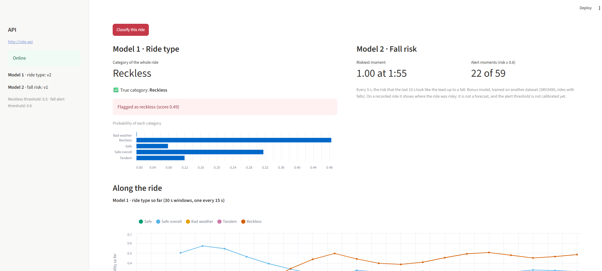
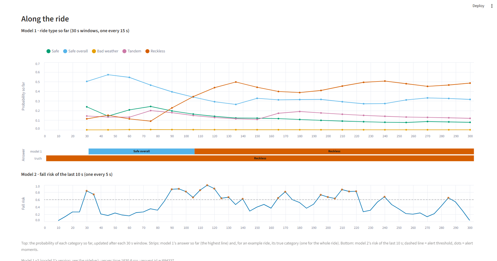

| | |
|---|---|
| 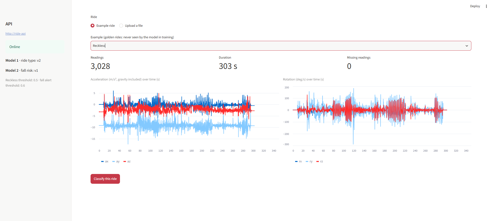 | 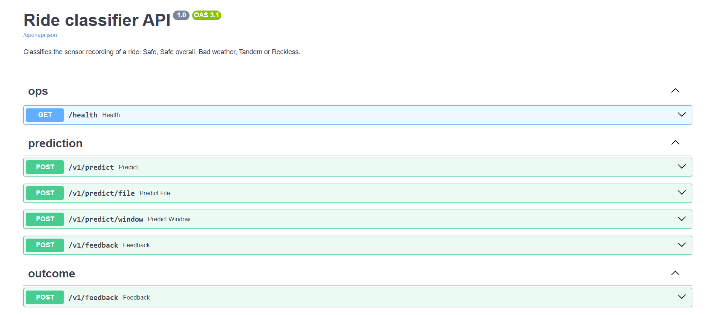 |
| Web app: both model versions, the 5 golden example rides | API documentation (:8080/docs) |
| 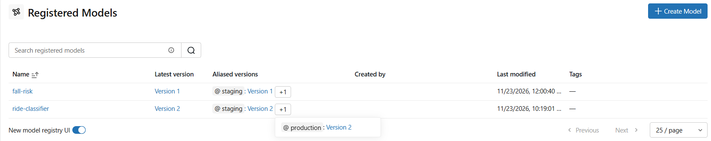 | 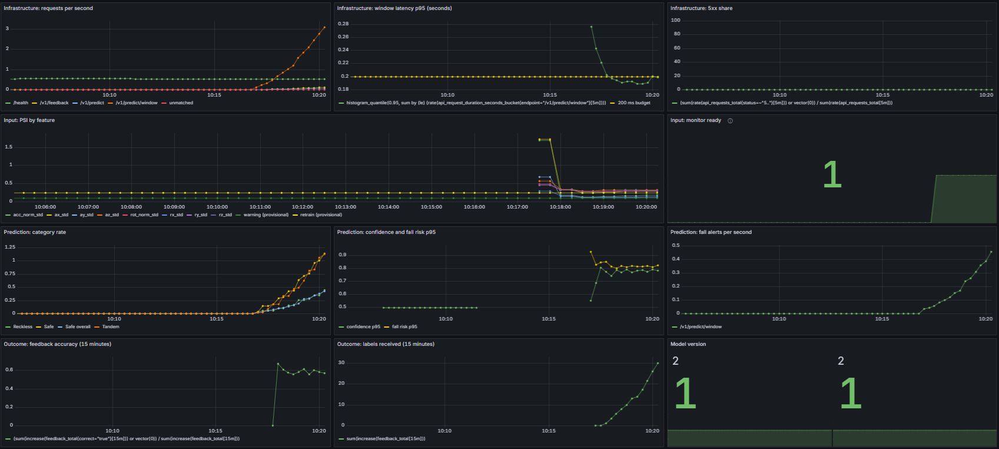 |
| MLflow in the cluster (:8082): both models, `@production` | Grafana (:8083): traffic, latency, predictions |
| 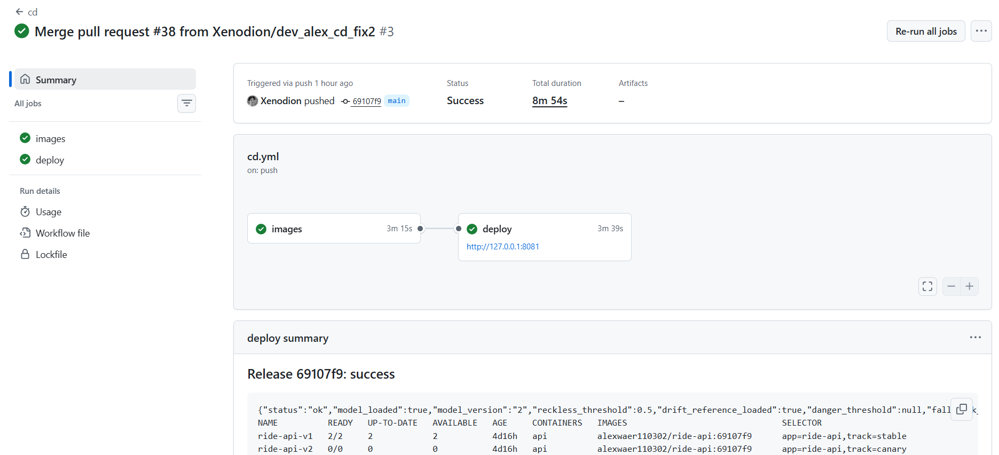 | 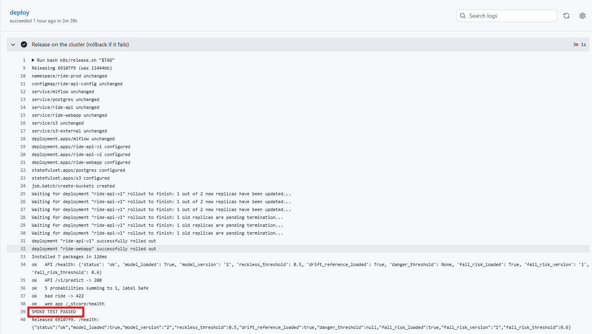 |
| GitHub Actions `cd`: images, then the release approved in `production` | The release log: rollout, smoke test on the cluster, tag recorded |

---

## Technical choices

The full reasoning is in [docs/PLAN.md](docs/PLAN.md) (decisions DEC-1 to DEC-10) and
[docs/decisions/](docs/decisions/README.md) (ADRs 001 to 011).

- **Data and evaluation.** 100 golden rides frozen once (stratified) and used only for the final score and the gate;
  5-fold CV on the other 400. The raw files are versioned with DVC; git keeps only their md5 pointers.
- **Model 1 = CNN on windows.** 400 training rides are few for deep learning: cutting rides into 30 s windows every
  15 s gives ~7,500 examples. Each window is classified on its own, and a ride gets the mean of its windows'
  probabilities, which also gives a live "category so far". Class weights are the square root of the inverse
  frequency (balanced weights over-predicted the rare classes, E1).
- **Model 2 = fall risk** on SRV3490, as two separate models served by one API (ADR 001, ADR 010): a ride's category
  describes the whole ride, a fall risk describes a moment. The API serves model 1 alone if model 2 is missing.
- **Quality gate and registration rules.** The `evaluate` stage fails the pipeline below the gate. A run is
  registered only if its code was committed (`git_dirty=False`), it passed the gate, and it is not worse than
  `@production`. Promotion to `@production` is a human step.
- **Images carry code only** (ADR 007): the repository and Docker Hub are public, and the course data and models
  must not be published. The API loads `@production` from MLflow at startup, resolved to an exact version first, so
  `/health` reports exactly what runs. A new model needs no new image.
- **Three MLflow servers, one registry history.** Dev (each laptop), shared (GCP, the team's), cluster (prod).
  `make k8s-model` copies versions with their runs, files and aliases, keeping the version numbers.
- **Kubernetes like the course's lab 5:** kind, NodePorts, startup / readiness / liveness probes on `/health`,
  CPU and memory limits, ConfigMap and Secrets (created from environment variables, never committed), a canary
  Deployment at 0 replicas for the rollback drill, image tags pinned in one place (`k8s/kustomization.yaml`).
- **CD with a human gate and a safety net.** Images are built on GitHub's machines; only the release runs on the
  self-hosted runner (GitHub can't reach the laptop's cluster). It never runs on pull requests, so code from a fork
  never reaches it. The release re-applies the previous version if the rollout or the smoke test fails.
- **Monitoring in four layers** (course S6): infrastructure, inputs (drift histograms against the reference of the
  served model), predictions, outcomes (`/v1/feedback`). Alert thresholds are provisional until calibrated.

---

## Quick start

Requirements: [uv](https://docs.astral.sh/uv/), Docker, and `make` (on Windows: Git Bash).

**Dev:**

```bash
make install     # uv sync + git hooks (Python 3.14 is downloaded by uv if needed)
make test        # 189 tests
make dev-up      # S3 + Postgres + MLflow, MLflow on http://localhost:5000
make data        # the versioned data (dvc pull)
make pipeline    # prepare -> train -> reference -> evaluate (quality gate), ...
make register    # register the model as @staging (only if committed and gate passed)
make app-up      # API on http://127.0.0.1:8000/docs and web app on http://127.0.0.1:8501, in Docker
```

**Production on kind** (images from Docker Hub, models copied into the cluster's MLflow):

```bash
make kind-up && make kind-load && make k8s-secrets && make k8s-deploy && make k8s-model
make k8s-monitoring   # Prometheus (:8084), Grafana (:8083), drift exporter
make k8s-examples     # the 5 golden example rides in the web app, for a one-click check
```

**Releases** then go through `cd.yml` on every merge into `main` (set-up: self-hosted runner with the label
`prod-host`, environment `production` with reviewers), or by hand with the same script:
`make k8s-release TAG=<commit>`. Details: [docs/how_to_use.md](docs/how_to_use.md) §12 and §13.

---

## Repository layout

```
src/ride_classifier/   all Python code: data, features, models, pipeline, registry (MLflow), api, drift, replay
webapp/                Streamlit app (example rides are generated locally: make webapp-examples)
tests/                 unit/ (mirrors src/), integration/ (container and cluster smoke tests)
docker/                one Dockerfile per image: api/, webapp/, mlflow/
k8s/                   Kubernetes manifests (storage, mlflow, api, webapp, monitoring) and release.sh
.github/workflows/     ci.yml, cd.yml, train.yml, drift.yml
monitoring/            Prometheus rules and Grafana dashboard
loadtest/              Locust (live rides streaming their windows)
notebooks/             exploration and the figures in assets/figures/
ai-infrastructure/     second course: benchmarks, sizing, optimization, cost
docs/                  usage guide, plan, decision records, framing, runbooks, journal
```

## Data

The raw data is versioned with DVC; git only stores the pointer files `data/raw/*.dvc` (md5 of the exact version).
Each laptop has an S3 remote in its dev stack, and the team shares a private bucket on GCP:

```bash
make data-setup        # once: DVC credentials for your local S3
make data              # dvc pull from your local S3
make shared-data-pull  # or from the shared bucket (see "Working as a team")
```

The pipeline (`dvc.yaml`, `make pipeline`, `uv run dvc dag`): `prepare` (clean, golden split, folds) →
`train` (CV + final model, logged to MLflow) → `reference` (drift reference, stored with the run) → `evaluate`
(golden scores, macro-F1 vs elapsed time, quality gate); `prepare_srv` → `falls` → `train_fall_risk` for model 2.
Commit **before** training: only runs from committed code are registered.

## Working as a team: shared MLflow and data

Each laptop has its own dev stack, which is enough to work alone. To **see the team's runs and share the versioned
data**, use the shared services on GCP (private, [ADR 011](docs/decisions/011-shared-mlflow-and-dvc-on-gcp.md)),
with your school account:

```bash
gcloud auth login --no-launch-browser     # school account (copy-paste login: kind uses port 8085)
gcloud auth application-default login --no-launch-browser   # same account: used by DVC for the shared bucket
make shared-mlflow                        # shared MLflow on http://localhost:5001 (keep it running)
make shared-data-pull                     # data from the shared bucket (instead of `make data`)
```

If your machine already has Google credentials for another project, log in with an isolated config and point DVC
at it, in the git-ignored local DVC config:

```bash
CLOUDSDK_CONFIG=~/.gcloud-school gcloud auth application-default login --no-launch-browser
uv run dvc remote modify --local shared credentialpath ~/.gcloud-school/application_default_credentials.json
```

Rule: **every run is tracked in MLflow**; data, models and credentials are never committed.

---

## Limits and known gaps

- **Little labelled data:** 500 rides, 6 Reckless (1 in the golden set). Scores have a wide spread (CV ±0.07); the
  Reckless recall rests on one ride. Accuracy was not the goal of the brief; beating random was.
- **Whole-ride predictions are slow** (2–4 s for 4–7.5 min rides): they compute the full timeline with both models
  on 1 CPU. The live endpoint, which the latency budget is about, meets it.
- **Drift alert thresholds are provisional** (not calibrated on real production traffic).
- **The prod host is one laptop:** the self-hosted runner runs only while `run.cmd` is open, and the cluster stops
  with the laptop. A backup host can redeploy everything from Docker Hub and the manifests.
- **Capacity under concurrent live rides is not measured** (no load test with a separate load generator, no
  autoscaling); see [AI infrastructure](#ai-infrastructure).
- **Retraining and drift workflows not yet exercised on GitHub:** `train.yml` has never run; the one scheduled
  `drift.yml` run failed before the report (Windows runner resolved `bash` to WSL, fixed with Git Bash + default `shell: bash` in `train.yml` and `drift.yml`, awaiting a live runner check). The drift
  scenarios were run offline (unit bug and new city detected); the recorded drift demo on kind remains open.

---

## AI infrastructure

Second course on the same project (Advanced Cloud AI Infrastructure): explain what the model needs to run, measure
it as it is, compare alternatives, and pick an infrastructure justified by those measurements. Model quality is not
the goal; every choice must rest on a measurement, and every number says whether it was **measured** or **estimated**.

Method: the registered models are the fixed reference (ride classifier E3 v2, fall-risk v1). Each experiment
changes one thing, its protocol is written before it runs, raw results are saved in the repo and the runs are logged
in MLflow. Start with [ai-infrastructure/README.md](ai-infrastructure/README.md), the
[analysis notebook](ai-infrastructure/benchmarks/benchmark.ipynb) (runs from saved CSV/JSON, no private data) and
the [evidence index](ai-infrastructure/benchmarks/evidence-index.md) (every number → raw file, Vertex job, MLflow run).

All numbers below are **measured** unless marked *estimated*. GPU runs: Vertex AI, one Spot `a2-highgpu-1g`
(A100 40 GB) in `europe-west4`, CPU and CUDA variants run on the same worker; medians of 3 rounds.

| Part | Before | After / result | Evidence |
|---|---|---|---|
| 1. Resource sizing | – | Classifier: 193 KB model, 30 s × 6 channels input, training 1,580 MiB RAM (CPU) / 29 MiB GPU tensors. Fall risk: 9 KB model, training 2,982 MiB RAM on a laptop (21.6 min). Data: 30 MB (GBG500) and 268 MB (SRV3490). **One machine is enough.** | [resource-sizing.md](ai-infrastructure/architecture/resource-sizing.md) |
| 2. Baseline benchmark | – | Network alone on laptop CPU: 0.99 ms / window at batch 1, ~10,100 windows/s at batch 128. Full API (both models, one client): live p95 **73 ms** CPU vs **71 ms** with the classifier on A100: the GPU brings no gain to serving. Macro-F1 unchanged (0.511). | [baseline-results.csv](ai-infrastructure/benchmarks/baseline-results.csv), [vertex-gpu-summary.md](ai-infrastructure/benchmarks/results/vertex-gpu-summary.md) |
| 3. Optimization | PyTorch CPU | ONNX Runtime FP32, classifier network on CPU: batch 1 **0.73 → 0.26 ms** (×2.8), batch 128 **3,565 → 6,809 windows/s** (×1.9); same class on all 1,885 windows. API (`INFERENCE_RUNTIME=onnx` / `onnx-int8`) and `compare_onnx.py --include-int8` added; real-weights INT8 run not yet executed. | [results-summary.md](ai-infrastructure/optimization/results-summary.md) |
| 4. Distributed training | 1 CPU | Classifier training stage **213 s CPU → 34 s on one A100** (×6). DDP / FSDP / ZeRO **not justified**: the model is tiny and one GPU trains it in about 30 s; no multi-GPU run claimed. | [technical-analysis.md](ai-infrastructure/distributed-training/technical-analysis.md) |
| 5. Scaling, cost, resilience | kind on one laptop | Serve on **CPU**: one `n1-standard-4` VM *estimated* $153 / month compute only (2 VMs: $305). Rollback: on kind a failed release rolled back automatically with the API answering 200 throughout (see [Production](#production-measured-on-the-kind-cluster-2411)). | [infrastructure-plan.md](ai-infrastructure/cost-resilience/infrastructure-plan.md) |

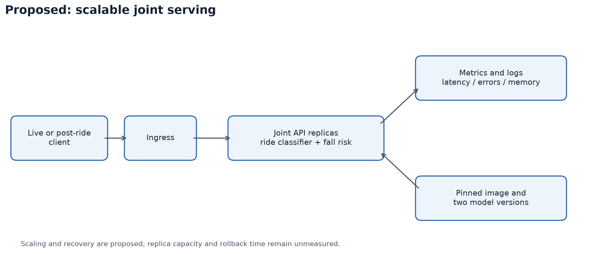

**Recommended infrastructure:** serve both models from CPU replicas (no GPU: it does not lower API latency here),
with the classifier exported to ONNX as the next optimization; train on demand on a single GPU worker (Spot), not
distributed. Add replicas only after a load test with a separate load generator: on a shared host, live p95 rose
from 111 ms (1 client) to 1.2 s (4 clients), so capacity per replica is **not yet measured**.

**Not done / open:** concurrent-load capacity on kind/cloud and autoscaling, real-weights INT8 benchmark run (code ready via `--include-int8` and `INFERENCE_RUNTIME=onnx-int8`), multi-GPU run, regional
price confirmation from Google's official page, total GPU process memory (only allocator memory was captured).
