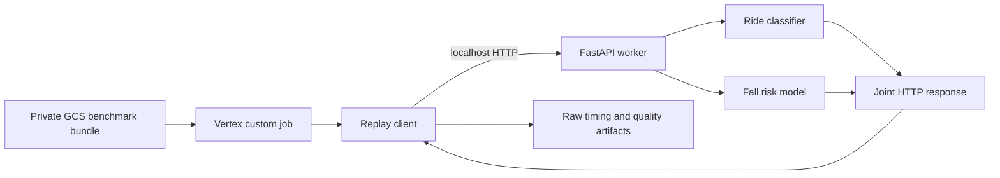
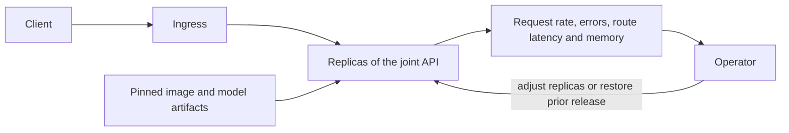

# Joint inference service

## Measured path on Vertex

The client sends a whole ride or a window from the same sensor stream. In live mode it passes the returned state with the next window. The response contains the ride classification and a separate fall-risk output. The measured path excludes external network latency.

## Proposed deployment

Keeping both models in each replica preserves the joint response with one request. Readiness should require both models. Version the image and both model references together so recovery restores a tested combination. During a rollout, keep successive live windows on a compatible release until the ride ends. Determine the replica count from concurrent mixed-traffic tests with a target p95 for each route. Sequential loopback latency alone cannot establish capacity.
