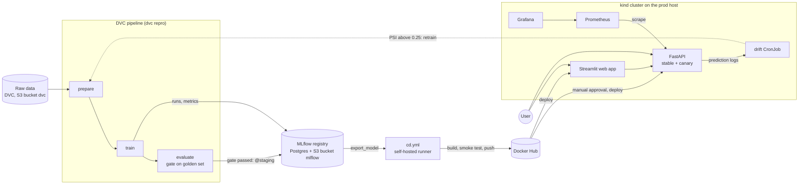

# Plan of action: ride classification MLOps project

**Status:** draft v2 for team review, 16/11/2026. Aligned with the course material for S1–S5 (`lectures/`, `labs/`).
**Deadline:** Wed 25/11/2026, 20:00 · **Presentation:** Thu 26/11/2026 (10 min + 10 min Q&A)

> **Rule:** nobody writes code until the team approves this plan. Approval = this file is merged into `main`.
> Comment on the PR to change anything. Every decision below marked *Proposed* needs a yes or an alternative.

Requirements and grading criteria are in [project_guidelines.md](project_guidelines.md).

---

## 1. Goal

Build an end-to-end MLOps system that takes the IMU recording of one ride and classifies it into one of five
categories: **Safe, Safe overall, Bad weather, Tandem, Reckless**. It is served through an API and a web app on
Kubernetes, with experiment tracking, a data/training pipeline, CI/CD and tests.

Accuracy is not the main grading point: the model has to beat random. A coherent, automated, documented system matters more.

### Grading criteria and where this plan covers them

| Criterion | Covered by |
|---|---|
| Code quality (best practices, modularity, docs) | Repo layout §7, ruff + type hints + docstrings, reviews §13 |
| Pipeline automation (CI/CD) | DVC pipeline §6, GitHub Actions §10 |
| Model tracking and management with MLflow | §8 |
| API functionality and usability (Swagger) | §9 |
| Objectives achieved, architecture consistency | §5, baselines §6.4 |
| Collaboration and versioning on GitHub | §13 |

---

## 2. What we reuse from the course

The course builds one reference project (a fraud classifier) session by session. We reuse its patterns, so the
graders recognise them and we don't reinvent anything.

| Session | Pattern from class | Where in this plan |
|---|---|---|
| S1 MLOps intro | **Baseline first:** a simple model tested end to end, then iterate. MLOps maturity levels. | §6.3, §15 (presentation) |
| S1 DVC (lab 1) | `dvc add` raw data, S3 remote, `dvc pull` on a fresh clone | §4.3 |
| S2 MLflow (lab 1) | Run tags `git_commit`, `git_dirty`, `data_md5`; commit before training; aliases `@staging` / `@production` (stages are deprecated); `repro_check.py` | §8 |
| S2 Docker (lab 2) | `export_model.py` pulls the model by alias into `model/`, baked into the image; deps layer before code; no secrets in images | §7, §8 |
| S3 CI/CD | **Evaluation gate** on a frozen golden set, **manual approval** before production; workflow = build → smoke test → push, image tagged with the 7-char commit sha (lab 2) | §10 |
| S4 Serving (lab 3) | FastAPI, routes under `/v1`, model loaded once in `lifespan`, strict Pydantic contract (`extra="forbid"`), 422 vs 500 vs 503, `/health` = 503 without a model, request-id and timing headers, Locust | §9 |
| S5 Kubernetes (lab 5) | kind cluster + NodePort port mapping, Deployment `track: stable` + canary Deployment, probes on `/health`, requests/limits, ConfigMap/Secret, Makefile, load test 1 vs 3 replicas, p95 ≤ 200 ms latency budget, cost per 1,000 predictions | §11 |
| S6 Monitoring | Four metric layers (lab 5 `metrics.py`): infrastructure, input distribution, prediction distribution, business outcome via `/feedback`; JSONL prediction logs | §12 |
| S7 Drift | K-S, chi-squared, PSI (alert 0.1, retrain 0.25), Evidently; replay of "current" traffic | §12 |
| S8 Canary and rollback | Canary by replica ratio, rollback under 5 min, incident report | §11, §12 |

Not in the repo yet: the S3 CI/CD slides (the gate and approval details above come from the S5 roadmap slide and
lab 5's `params.yaml`), and S6–S8. Re-check §10–12 after each of those sessions.

---

## 3. Decisions

| # | Decision | Proposal | Status |
|---|---|---|---|
| DEC-1 | Task framing | 5-class classifier, as the guidelines require. Reckless recall reported as the headline safety metric; the API also returns a `reckless_score` and an `is_reckless` flag. | Proposed |
| DEC-2 | SRV3490 (multi-city crash data) | **Not used at all.** It answers a different question (crash detection) and has no labels for our 5 categories. The project uses GBG500 only. | **Decided** (16/11) |
| DEC-3 | Pipeline / DAG tool | DVC pipeline (`dvc.yaml`, `dvc repro`, `dvc dag`), as in the lab 5 reference project. No Airflow. | Proposed |
| DEC-4 | Model | Baseline first (per-ride statistics + scikit-learn), shipped end to end. Then the PyTorch 1D CNN (CPU, E3) goes to production **to meet the guidelines' "deep learning model" objective**, not because it's better: the two are tied within the noise (CV favours the baseline 0.373 vs 0.357, golden the CNN 0.511 vs 0.477), and the data (5 Reckless rides) limits both. The baseline stays registered (v1) as the reference; the presentation shows the comparison. | **Decided** (19/11) |
| DEC-5 | Serving | Images carry **code only**: the public Docker Hub images must not contain the model nor course data (ADR 007). The API loads `models:/ride-classifier@production` (and model 2, `models:/fall-risk@production`) from MLflow at startup (`MODEL_URI`, `FALL_RISK_URI`, `MLFLOW_TRACKING_URI`), plus the drift reference logged with model 1's run; the cluster's MLflow gets the registered versions with `make k8s-model`. Image tag = commit sha. A new model needs no new image: move `@production`, restart the API pods. First version (19/11) baked `model/` into the image (labs 2 and 5). | **Decided** (23/11, task INF-4) |
| DEC-6 | Object storage | SeaweedFS (course setup, S3-compatible). Covers the "store the model on S3 / MinIO" requirement. | Proposed |
| DEC-7 | Image registry | Docker Hub (the guidelines ask for Docker Hub URLs; lab 2 used GHCR) | Proposed |
| DEC-8 | Production environment | **kind** cluster on one designated **prod host** laptop, as in the S5 lab (the guidelines also accept Docker Desktop Kubernetes or Minikube) | **In place** (19/11) on the laptop building the project; the self-hosted runner goes on the same machine |
| DEC-9 | Python version | 3.14, as in lab 5 and the MLflow image, set in `.python-version`. Fall back to 3.12 if PyTorch has no wheel for 3.14 (checked in FND-1). | Proposed |
| DEC-10 | `lectures/` and `labs/` in the repo | Git-ignored and untracked; kept on disk for reference while building. | **Decided** (16/11) |

---

## 4. Data

### 4.1 Files

We use **GBG500 only** (DEC-2). `SRV3490.parquet` stays out of the project: not versioned, not loaded.

| File | Content |
|---|---|
| `GBG500.parquet` | 500 rides in Gothenburg, 1.53 M rows (one per sensor reading), 3–8 min per ride (1,807–4,767 readings) |
| `GBG500_labels.csv` | **One label per ride** (500 rows), joined on `ride_id`: Safe 416, Safe overall 38, Bad weather 22, Tandem 18, Reckless 6 |

Sensor data, one row per reading:

| Column | Meaning |
|---|---|
| `ride_id` | 64-char hash, the key to the labels file (`RIDE_ID` there) |
| `time_index` | ms since ride start; starts at 0, step 100 ms (**10 Hz**) |
| `ax`, `ay`, `az` | accelerometer, m/s², gravity included (`ay` ≈ −9.2: y axis is roughly vertical); saturates near ±19.5 m/s² (≈ 2 g) |
| `rx`, `ry`, `rz` | gyroscope, deg/s |

The unit of prediction is the **ride**: 500 labelled examples, each a 3–8 minute recording.

### 4.2 Quirks and how preprocessing handles them

| Quirk | GBG500 | Handling |
|---|---|---|
| Rows with all 6 sensor values missing | 0.67 % (10,201 rows in 439 rides); gaps of 1–19 samples, never at ride start/end | Linear interpolation within the ride |
| Duplicate `(ride_id, time_index)` | 1 row | Keep first |
| Row order | sorted in the file | Sort anyway (cheap guard) |

### 4.3 Splits, storage and versioning

Same three-way split as the lab 5 reference project:

| Split | Content | Used for |
|---|---|---|
| `train` | ≈ 400 GBG500 rides (stratified) | Cross-validation, model selection, final fit |
| `golden` | ≈ 100 GBG500 rides, stratified, **frozen** (ride list versioned): Safe 83, Safe overall 8, Bad weather 4, Tandem 4, Reckless 1 | The evaluation gate (§10). Never used for training. |
| `current` | Golden rides replayed against the API, as-is and with a simulated sensor change (§12) | "Production traffic" for monitoring and the drift demo |

- Raw files live in `data/raw/`, tracked with `dvc add`: the `*.dvc` files go into git, the contents go into the S3 bucket `dvc`.
- `data/` is git-ignored (done 16/11).
- A teammate gets the data with `dvc pull`, or downloads it from Inside into `data/raw/`; `dvc status` confirms the hash.

---

## 5. Architecture



### Environments

| | Dev | Prod |
|---|---|---|
| Where | Each teammate's laptop | Prod host laptop, kind cluster, namespace `ride-prod` |
| How it starts | `docker compose up` (S3, Postgres, MLflow; API, web app and monitoring behind compose profiles), or `make api` for the API alone | Deployed **only** by GitHub Actions (self-hosted runner on the prod host) |
| MLflow | Local, for experiments | **Single source of truth** for registered and shipped models |

### Ports

kind reaches Services through NodePorts mapped to host ports in `k8s/kind-config.yaml` (lab 5 maps 30080 → 8080).
**These mappings are fixed when the cluster is created**, so they must be decided before K8S-1.

| Service | Dev (compose) | Prod (NodePort → host port) |
|---|---|---|
| API | 8000 | 30080 → 8080 |
| Web app | 8501 | 30081 → 8081 |
| MLflow | 5000 | 30082 → 8082 |
| Grafana | 3000 | 30083 → 8083 |
| Prometheus | 9090 | 30084 → 8084 |
| S3 filer | 8888 | 30085 → 8085 |
| S3 API (DVC remote for the training workflow, K8S-4) | 8333 | 30086 → 8086 |

---

## 6. ML pipeline

### 6.1 DVC stages

| Stage | Inputs | Outputs |
|---|---|---|
| `prepare` | `data/raw/GBG500.parquet`, `data/raw/GBG500_labels.csv`, `params.yaml` | `data/processed/train.parquet`, `data/processed/golden.parquet` (clean readings + label), `data/processed/splits.csv` (one row per ride: label, split, CV fold; **committed to git**, so the frozen golden list is visible and any change shows in a PR) |
| `train` | `train.parquet`, `splits.csv`, `params.yaml` | `artifacts/model/` (MLflow pyfunc), `artifacts/oof_predictions.csv`, `artifacts/cv_metrics.json` (DVC metrics: `dvc metrics show`), an MLflow run. Needs MLflow running (`make dev-up`). |
| `evaluate` | `artifacts/model/`, `artifacts/train_run.json`, `golden.parquet`, `params.yaml` (`evaluate:`) | `artifacts/golden_metrics.json` (DVC metrics), `artifacts/golden_predictions.csv`, `artifacts/golden_confusion_matrix.png`; golden scores + tag `gate=passed/failed` added to the **training's MLflow run**. **Exits non-zero if the gate fails**, which stops the workflow. |

Registering the model is **not** a DVC stage, because it changes the registry. CI runs `register.py` only after
`evaluate` passes (§10).

`params.yaml` sections, modelled on lab 5:

| Section | Contents |
|---|---|
| `data` | paths, `golden_share: 0.2`, `cv_folds: 5`, `seed: 42` (the split and the folds are made once, in `prepare`) |
| `train` | model type (`baseline` or `cnn`), window 30 s, stride 15 s, hyperparameters, class weights, augmentation on/off |
| `evaluate` | output paths; `gate.min_macro_f1` (a floor that catches broken models, calibrated after the first run like lab 5's comment says), `gate.must_beat_references: true` |
| `drift` | `psi_alert: 0.1`, `psi_retrain: 0.25`, `pvalue: 0.01` |

### 6.2 Preprocessing (shared by training and serving)

1. Sort, drop duplicate timestamps, interpolate gaps (§4.2).
2. Baseline: per-ride statistics per channel (mean, std, percentiles, jerk, magnitude, spectral energy).
3. CNN: cut each ride into 30 s windows (300 samples) with a 15 s stride (11–30 windows per ride), then standardize
   each channel with mean/std fitted on training data only.

The same code in `src/ride_classifier/` is packed into the MLflow pyfunc model. The API calls `model.predict(ride)`
and never knows which model is inside, so training and serving cannot diverge.

### 6.3 Models: baseline first

Following S1's "baseline first" principle:

1. **Baseline (ships first, M2):** per-ride statistics + logistic regression or gradient boosting with balanced class
   weights. It goes through the whole chain first: DVC → MLflow → gate → image → Kubernetes.
2. **CNN (replaces it at M3 if better):** 3 × (Conv1d → BatchNorm → ReLU → MaxPool), global average pooling, dropout,
   linear → 5 classes.
   - Loss: weighted cross-entropy.
   - Augmentation: random crop/shift, jitter, scaling.
   - Ride prediction = mean of its window probabilities.

The guidelines ask for a deep learning model, so the CNN is the target. The baseline means the system works from
day 4 whatever happens to the CNN.

**Reckless threshold:** `is_reckless = (predicted category is Reckless) or reckless_score ≥ threshold`, default **0.5**, overridden by the
`RECKLESS_THRESHOLD` env var (a ConfigMap value in Kubernetes). This is lab 5's `DECISION_THRESHOLD` pattern, and it
lets a canary differ from stable by threshold only. We don't tune it on data: out of fold, 4 of the 5 Reckless train
rides score ≈ 0 whatever the threshold, and every value from 0.3 to 0.7 flags the same 1 of 5 (0.5 gives 1 false
alarm out of 395 rides).

### 6.4 Evaluation

- **Model selection:** stratified 5-fold cross-validation on the ≈ 400 train rides, at ride level (all windows of a
  ride stay in one fold). Out-of-fold predictions give one confusion matrix.
- **Gate:** the final model is evaluated once on the frozen golden set. Its golden macro-F1 must reach
  `gate.min_macro_f1` **and** beat both references on the same rides: always answering "Safe" and random guessing
  (the course's "better than random", checked automatically). Beating the model currently in production (e.g. CNN vs
  baseline) is checked at registration (MOD-3), not by the gate.
- **Primary metric: macro-F1.** Also: balanced accuracy, recall per class (Reckless highlighted), and accuracy for
  reference only, because always answering "Safe" already scores 83 %.
- With 6 Reckless rides (5 in train, 1 in golden), Reckless recall is very noisy. Report the CV spread and the
  confusion matrices, and don't gate on Reckless recall.

| Reference point | Expected macro-F1 |
|---|---|
| Always "Safe" | ≈ 0.18 |
| Stratified random | ≈ 0.20 |
| Statistics baseline | measured, becomes the bar for the CNN |

### 6.5 Experiments (CNN, ends Sun 22/11)

Run on 19/11, all logged in MLflow (experiment `ride-classifier`, tag `experiment_id`). CNN = 30 s windows every
15 s, 3 conv blocks [32, 64, 64], kernel 7, dropout 0.3, augmentation, mean over windows.

| ID | Model | CV macro-F1 | Golden macro-F1 | Gate |
|---|---|---|---|---|
| E0 | Statistics baseline | **0.373** ± 0.062 | 0.477 | passed |
| E1 | CNN, balanced class weights, 20 epochs | 0.282 ± 0.072 | 0.177 | failed: over-predicts the rare categories (a Reckless window weighs 66x a Safe one) |
| E2 | CNN, **sqrt** class weights (8x), 20 epochs | 0.312 ± 0.068 | 0.286 | failed (< 0.30): overfits |
| E3 | CNN, sqrt class weights, **10 epochs** | 0.357 ± 0.071 | **0.511** | **passed** |

Selection: best out-of-fold macro-F1 among CNNs (E3), so the golden set wasn't used to choose. E3 and the baseline
are tied within the noise (fold spread ±0.07, golden = 100 rides); E3 is kept because it passes the gate, does at
least as well on golden (MOD-5 rule) and is the deep learning model the guidelines ask for.

Not tried (time): oversampling the rare-category rides, window length 10 / 60 s, mean of the top-k windows,
extra magnitude channels.

---

## 7. Repository layout and tooling

The skeleton was created on 16/11. Folders still empty hold a `.gitkeep` so git keeps them; delete it when you add
the first real file.

```
.
├── .github/workflows/
│   ├── ci.yml                lint + tests on every PR (exists); image build/smoke test added with INF-3
│   ├── train.yml             dvc repro → gate → register @staging
│   └── cd.yml                export model → build → push → approval → deploy
│
├── src/ride_classifier/      ALL the Python code, one package
│   ├── config.py             ride schema, label order, params.yaml + env vars (exists)
│   ├── data/                 load, clean, split
│   ├── features/             per-ride statistics (baseline), windows (CNN)
│   ├── models/               baseline, cnn, MLflow pyfunc wrapper
│   ├── pipeline/             prepare, train, evaluate (one file per DVC stage)
│   ├── registry/             register, export_model, repro_check (MLflow)
│   ├── api/                  FastAPI app
│   └── drift/                drift checks, traffic simulator
│
├── webapp/                   Streamlit app + a few example rides
├── tests/
│   ├── conftest.py           fake rides shared by all tests (exists)
│   ├── unit/                 mirrors src/ride_classifier/ (data/, api/, …)
│   ├── integration/          compose stack end to end
│   └── e2e/                  smoke test against the cluster
├── notebooks/                exploration only, never imported by src/
│
├── docker/                   api/  webapp/  mlflow/          one Dockerfile each
├── k8s/                      kind-config.yaml, kustomization.yaml
│                             storage/  mlflow/  api/  webapp/  monitoring/
├── s3/                       storage config (moved from infra/s3/)
├── monitoring/               prometheus.yml, grafana/ dashboards
├── loadtest/                 locustfile.py
├── docs/                     PLAN.md, DATA.md, runbook.md, incident_report.md
│
├── data/                     ignored: raw/ (DVC), processed/
├── artifacts/                ignored: trained model, metrics, plots
├── model/                    ignored: model exported for `make api` (local runs; images load from MLflow)
│
├── dvc.yaml  dvc.lock  params.yaml
├── pyproject.toml  uv.lock  .python-version
├── docker-compose.yml  .env.example
├── Makefile
├── .gitignore  .dockerignore  .gitattributes  .pre-commit-config.yaml
└── README.md
```

`labs/` and `lectures/` stay on disk for reference but are git-ignored (DEC-10).

**Four rules:**

1. **Python only lives in `src/ride_classifier/`**, never in `docker/` or `k8s/`. Training, the MLflow model and the
   API share the same cleaning code by importing it (`from ride_classifier.data import clean`).
2. **Tool folders at the top, one subfolder per service inside.** The API is `src/ride_classifier/api/`,
   `docker/api/`, `k8s/api/` and `tests/unit/api/`: same name everywhere.
3. **Generated files go in three ignored folders** (`data/`, `artifacts/`, `model/`) and are never committed.
4. **The root only holds files a tool requires there** (GitHub, DVC, uv, compose, Makefile).

Start each folder with one file and split it only when it gets long.

**Who owns what.** Whoever builds a service also writes its Dockerfile, its Kubernetes manifest and its tests:

| Workstream | Owns |
|---|---|
| WS1 Data and pipeline | `data/`, `features/`, `pipeline/`, `dvc.yaml`, `params.yaml`, `s3/`, `k8s/storage/` |
| WS2 Models and MLflow | `models/`, `registry/`, `docker/mlflow/`, `k8s/mlflow/` |
| WS3 API and web app | `api/`, `webapp/`, `docker/api/`, `docker/webapp/`, `k8s/api/`, `k8s/webapp/`, `loadtest/` |
| WS4 CI/CD and cluster | `.github/workflows/`, `k8s/kind-config.yaml`, `kustomization.yaml`, `docker-compose.yml`, `Makefile`, root config files |
| WS5 Monitoring and docs | `drift/`, `monitoring/`, `k8s/monitoring/`, `docs/`, `README.md` |
| Everyone | `tests/` next to the code you write, `notebooks/` |

**Tooling**, as in lab 5:
- uv with `uv sync --locked`, and dependency groups so each image installs only what it needs: `train`, `api`, `webapp`, `dev`.
- ruff: `line-length = 120`, rules `E, F, I, B, UP`.
- pytest: `testpaths = ["tests"]`, `pythonpath = ["src"]`.
- PyTorch from the CPU-only wheel index, to keep images small.

**Makefile targets**, the same names as in lab 5 where they exist:

| Target | What it does |
|---|---|
| `make pipeline` | `dvc repro` |
| `make api` | Run the API locally on port 8000 |
| `make image` | Build the API image |
| `make kind-up` / `make kind-down` | Create / delete the cluster |
| `make kind-load` | Build our MLflow image and load it into kind (the API and web app come from Docker Hub) |
| `make k8s-secrets` | Create the cluster secrets from env vars (`k8s/secrets.sh`) |
| `make k8s-deploy` / `make k8s-status` | `kubectl apply -k k8s/` and wait for the rollouts / list pods, services, jobs |
| `make load` / `make load-kind` | Locust against the local API / the cluster |

**Dockerfile pattern** (lab 5 API image):
- `python:3.14-slim` + uv; `pyproject.toml` + `uv.lock` copied first, then the code. **No model, no data** (DEC-5).
- Non-root `appuser`, `HEALTHCHECK` on `/health`, `MODEL_URI=models:/ride-classifier@production`,
  `MLFLOW_TRACKING_URI=http://mlflow:5000` (the MLflow service name in compose and in the cluster).
- Built from the repo root so the image can copy `src/` and `pyproject.toml`: `docker build -f docker/api/Dockerfile .`
  (`make image` does it). One `.dockerignore` at the root keeps `data/`, `.venv/`, `notebooks/` and `.env` out.
- No secrets in the image (lab 2).

---

## 8. MLflow conventions

- **Environment variables:** `MLFLOW_TRACKING_URI`, `MLFLOW_EXPERIMENT_NAME` (S2 lecture), `MODEL_NAME` (labs). Local
  MLflow for experiments, prod MLflow for anything that ships.
- **Downloads go through the server:** `MLFLOW_ENABLE_PROXY_MULTIPART_DOWNLOAD=false`, set by default by our package.
  Otherwise MLflow 3.17 hands out direct S3 links with the storage's Docker-internal name (`http://s3:8333`), and
  downloads from a laptop or CI hang.
- **Experiment:** `ride-classifier`. **Registered model:** `ride-classifier`.
- **Every run logs:**
  - params: all of `params.yaml`
  - tags (lab 1): `git_commit`, `git_dirty`, `data_md5` (from `GBG500.parquet.dvc`), plus `model_type` and `experiment_id` (E0–E6)
  - metrics: per CV fold, mean and std, and golden-set metrics
  - artifacts: confusion matrices, classification report, out-of-fold predictions
- **Commit before training**, so `git_dirty` is `False` (lab 1). A dirty run is never registered.
- **Model:** logged as a pyfunc with signature and input example. Input = one ride as a DataFrame
  (`time_index, ax, ay, az, rx, ry, rz`); output = 5 class probabilities.
- **Artifact store:** S3 bucket `mlflow`. This is how we meet "store the model on S3".
- **Aliases** (stages are deprecated, lab 1):
  - `@staging`: newest model that passed the gate (set by `register.py` in `train.yml`)
  - `@production`: the version deployed as stable, set only after the manual approval in `cd.yml`
    (`register.py --promote` moves it to the version currently `@staging`)
- **Registration rule** (`register.py`, refuses with the reasons otherwise):
  - trained on committed code (`git_dirty=False`), so it can be rebuilt
  - passed the quality gate (`gate=passed`)
  - golden macro-F1 at least as high as the version currently `@production` (e.g. a CNN must not do worse than the baseline)

  Registering the same run twice reuses its version. Each version carries tags: run id, git commit, data md5,
  CV and golden macro-F1.
- **Export:** `export_model.py` downloads `models:/ride-classifier@<alias>` into `model/` with a `model_meta.json`
  (name, version, alias, run, commit, data, scores), which the API reads at startup (lab 5). The Reckless
  threshold is added to it with the API (API-3).
- **Reproducibility:** `repro_check.py [run_id]` checks that the training code (`src/` minus `registry/`,
  `params.yaml`, `uv.lock`) and the raw data are those of the run, then reruns prepare → train → evaluate in a
  temporary folder (with a throwaway MLflow store) and compares every CV and golden score within 1e-6.
  Code from another commit or other data → it says which `git checkout` / `make data` to do (lab 1 deliverable).

---

## 9. API and web app

### 9.1 API (FastAPI)

Patterns from labs 3 and 5:
- **Model loading:** once, in `lifespan`, from `MODEL_URI`: a `models:/<name>@<alias>` URI in the images (the alias is
  resolved to its version first, so `/health` reports exactly the version loaded), or the `model/` folder of
  `make export` for `make api`.
- **Strict contract:** Pydantic with `extra="forbid"`, `Field` constraints and descriptions, so `/docs` documents every field.
- **Error codes:** 422 = the caller's mistake, 500 = ours (generic body, no stack trace, request id), 503 = no model loaded.
- **Headers:** every response carries `X-Request-ID` and `X-Process-Time-Ms`; a request slower than 200 ms logs a `SLOW` warning.
- **Prediction log:** one JSON line per prediction (input summary: readings, missing share, a few channel spreads;
  probabilities, label, `model_version`, `inference_ms`) to stdout and to `PREDICTION_LOG_PATH`. The drift job reads it.
- **Model version:** read from `model_meta.json` (written by `export_model`) and returned with every prediction.

| Method | Path | Purpose |
|---|---|---|
| POST | `/v1/predict` | One ride as JSON → prediction |
| POST | `/v1/predict/file` | One ride as a CSV or parquet upload → prediction |
| POST | `/v1/feedback` | True label received later → monitoring layer 4 (lab 5). **Added with OPS-1** |
| GET | `/health` | `200 ok` with model version and threshold, or **`503 degraded`** without a model (lab 3). Used by both Kubernetes probes. |
| GET | `/metrics` | Prometheus metrics (`prometheus_client`, as in lab 5): requests, latency and predictions per category from API-1; input-distribution metrics with OPS-1 |
| GET | `/docs` | Swagger UI (built into FastAPI) |

Lab 5's `/health` answers 200 even when degraded, so a readiness probe on it can't catch a missing model. We follow lab 3.

**Request:** columnar arrays, one per channel. A ride has about 3,000 samples, and validating 3,000 small objects
would eat into the 200 ms latency budget (§11).

```json
{
  "ride_id": "optional",
  "time_index": [0, 100, 200],
  "ax": [-2.51, -2.49, -2.53],
  "ay": [-9.39, -9.39, -9.38],
  "az": [-1.05, -1.08, -1.03],
  "rx": [-0.01, -0.04, 0.04],
  "ry": [0.01, 0.03, 0.03],
  "rz": [-0.20, -0.16, -0.07]
}
```

**Response:**

```json
{
  "ride_id": "optional",
  "label": "Safe",
  "probabilities": {"Safe": 0.91, "Safe overall": 0.04, "Bad weather": 0.02, "Tandem": 0.02, "Reckless": 0.01},
  "reckless_score": 0.01,
  "is_reckless": false,
  "model_version": "3",
  "n_readings": 2349
}
```

**Validation (422):**
- unknown fields
- arrays of different lengths
- fewer than 300 samples (30 s) or more than 20,000
- `time_index` going backwards (a repeated timestamp is accepted and dropped, as in training)
- values outside physical bounds (acceleration beyond ±100 m/s², rotation beyond ±2000 deg/s), NaN or infinity

Null sensor values are accepted and interpolated, as in training. The gyroscope is expected in deg/s, as in GBG500.

### 9.2 Web app (Streamlit; the S1 lecture names Gradio or Streamlit)

- Upload a ride (CSV or parquet) or pick one of the example rides shipped with the app.
- Plot the 6 signals over time.
- Call the API (`API_URL` env var) and show the label, a probability bar chart and the model version.
- The web app holds no model; it is only an API client.

---

## 10. CI/CD (GitHub Actions)

| Workflow | Trigger | Runner | Steps |
|---|---|---|---|
| `ci.yml` | every PR and push | GitHub-hosted | `uv sync --locked` → ruff → unit and API tests (stub model) → build api and webapp images → **container smoke test**: start the API image with a tiny test model, call `/health` and `/v1/predict` (lab 2: "test the container, not only build it") |
| `ci.yml`, integration job | PR to `main` | GitHub-hosted | `docker compose up` (S3, Postgres, MLflow) → train the baseline on synthetic rides → register → export → start API → `POST /v1/predict` |
| `train.yml` | manual; push to `main` touching model code, `params.yaml` or `dvc.lock`; schedule or drift alert (bonus) | self-hosted (prod host) | `dvc pull` → `dvc repro` (**the `evaluate` stage is the gate**: below threshold, the run fails and nothing is registered) → `register.py` → `@staging` |
| `cd.yml` | push to `main` touching code, images or `k8s/`; manual | job `images`: GitHub-hosted; job `deploy`: self-hosted (prod host, label `prod-host`) | `images`: build both images (code only, DEC-5) → container smoke test with test models → push to Docker Hub as `<sha7>` + `latest`. `deploy`: **manual approval** (GitHub environment `production`) → `k8s/release.sh <sha7>`: tag in `kustomization.yaml` → `kubectl apply -k k8s/` → `kubectl rollout status` → smoke test on the cluster → `kubectl rollout undo` if anything fails → the bot commits the new tag to `main`, so git says what runs. Models are released separately (no model in the images): `make promote`, `make k8s-model` |

- **Secrets:** `DOCKERHUB_USERNAME` and `DOCKERHUB_TOKEN` as GitHub secrets. Prod MLflow, S3 and DVC credentials stay on
  the prod host (runner environment, Kubernetes Secrets), never in the repo or an image.
- **Manual approval:** a GitHub environment `production` with required reviewers. Free: the repository is public.
- **Branch protection on `main`:** PR required, 1 approval, `ci.yml` green.
- **Self-hosted runner safety:** it only runs on `push` to `main`, workflow completion and manual triggers, never on
  `pull_request`. A PR from a fork could otherwise run arbitrary code on the prod host.

---

## 11. Kubernetes (production)

kind cluster on the prod host, created from `k8s/kind-config.yaml` (port mappings from §5), namespace `ride-prod`.
Plain manifests applied with Kustomize (`kubectl apply -k`), mirroring `docker-compose.yml` and lab 5:

| Component | Kind | Notes |
|---|---|---|
| SeaweedFS (S3) | StatefulSet + PVC | Buckets `mlflow` and `dvc` created by a Job |
| Postgres | StatefulSet + PVC | MLflow backend store (S5: "a database, if run in the cluster") |
| MLflow | Deployment | Our `docker/mlflow` image |
| API stable | Deployment `ride-api-v1`, labels `app: ride-api, track: stable`, 2 replicas (3 for the load test: the prod host's Docker has 8 GB) | Startup probe (PyTorch takes a while to load), then readiness and liveness on `/health`; requests 250m / 512Mi, limits 1 CPU / 1Gi (lab 5's 100m / 256Mi → 500m / 512Mi, raised for PyTorch) |
| API canary | Deployment `ride-api-v2`, `track: canary`, 0 replicas by default | Same probes and resources as stable (lab 5 TODO 3) |
| API Service | NodePort 30080, selector `app: ride-api` | Spreads traffic over stable + canary pods |
| Web app | Deployment + NodePort 30081 | `API_URL` = in-cluster Service |
| Config | ConfigMap `ride-api-config`: `RECKLESS_THRESHOLD`, `PREDICTION_LOG_PATH`. Secrets `storage-credentials` (S3 keys, Postgres password) and `seaweedfs-s3-config`, created by `k8s/secrets.sh` from env vars, never committed | S5: config changes need no image rebuild. The model is inside the API image, so no alias setting |
| Drift check (bonus) | CronJob | S5 workloads table: "nightly drift check" |
| Prometheus + Grafana (bonus) | Manifests or Helm chart, to settle after S6 | Scrape `/metrics` |

- **Images:** the API and web app come from Docker Hub, their tags pinned in the `images:` block of
  `k8s/kustomization.yaml` (CD changes only those lines). Only our MLflow image is built locally and loaded with
  `kind load docker-image` (`make kind-load`).
- **Model:** not in the image (DEC-5). The API pods load `@production` from the cluster's MLflow
  (`http://mlflow:5000`, set in the ConfigMap) at startup. `make k8s-model` copies the registered versions, their runs
  and aliases from a source MLflow (dev by default, or the shared one) into it, with the same version numbers.
  A model rollback = move `@production` back, then `kubectl rollout restart deployment/ride-api-v1`.
- **Canary (S5, S8):** scale stable to 9 and canary to 1 for ≈ 10 % of traffic. Rollback = scale canary to 0.
  A bad stable release: `kubectl rollout undo deployment/ride-api-v1`, then move `@production` back.
  **Target: rollback in under 5 minutes**, rehearsed and written up in `docs/runbook.md`.
- **Sizing report (S5 lab, goes in the README):**
  - the same Locust profile on 1 and 3 replicas: p95 and requests/s
  - a latency budget table with target **p95 ≤ 200 ms**, split into network, validation, preprocessing, inference and response
  - cost per 1,000 predictions = `(C_h × replicas × 1000) / (throughput_rps × 3600)`
- **HPA:** optional stretch. It needs metrics-server, which kind doesn't include. The lab scales replicas by hand.

---

## 12. Monitoring, drift, retraining (bonus)

Four metric layers, as in lab 5 `metrics.py`, plus logs:

| Layer | Metrics |
|---|---|
| 1. Infrastructure | `api_requests_total{endpoint,status}`, `api_request_duration_seconds{endpoint}`, pod CPU/memory, restarts |
| 2. Input distribution | ride length, share of missing values, per-channel std of a few channels (e.g. `ay`, `ry`) |
| 3. Prediction distribution | `prediction_label_total{label}`, `reckless_score` histogram, `model_info{version}` |
| 4. Business outcome | `feedback_total{predicted,actual}` from `/v1/feedback` |
| Logs | JSONL prediction log (§9.1) |

- The Grafana dashboard is committed as JSON in `monitoring/`.
- **Where the logs live in the cluster:** pod filesystems are temporary, so the API writes to a PVC that the drift
  CronJob also mounts. A single-node kind cluster allows this. To confirm after S6.
- **Drift (S7):** `drift.py` compares recent prediction logs with the train split's per-ride features:
  - K-S test per numeric feature (p < `drift.pvalue`)
  - chi-squared on the predicted label distribution
  - PSI per feature: alert above 0.1, retrain above 0.25
  - an Evidently HTML report as an artifact
- **Demo:** `simulate.py` replays golden rides as-is (no drift expected), then the same rides with a simulated sensor
  change, for example gyroscope values scaled down or extra noise, as after a firmware update. Drift fires and triggers `train.yml`.
- **Incident report (S8):** run one rollback drill (for example a canary with a bad threshold) and write it up in
  `docs/incident_report.md`: detection, impact, rollback time, cause, fix.

---

## 13. Ways of working

- **Branches:** short-lived `feat/…`, `fix/…`, `docs/…` branches from `main`, one task per branch.
- **Pull requests:** small, linked to their issue, reviewed by one other teammate, CI green, squash-merged.
- **Commits:** Conventional Commits (`feat:`, `fix:`, `docs:`, `test:`, `ci:`, `chore:`), as already used in the history.
- **Tracking:** one GitHub issue per task in §14, a label per workstream, milestones M0–M5, a GitHub Project board.
- **Code:** ruff through pre-commit, type hints, docstrings on public functions.
  Exploration notebooks go in `notebooks/` and are never imported by `src/`.
- **Definition of done:** code + tests + docs updated, CI green, reviewed, merged.
- **Sync:** 10-minute daily stand-up (chat is fine): done / next / blocked.

---

## 14. Work breakdown

### 14.1 Interfaces fixed on day 1

These three contracts let every workstream start in parallel. The API and web app are built against a stub model,
and the baseline and CNN plug into the same contract.

1. **Ride DataFrame schema:** columns, dtypes, units, label names and their order.
2. **Model contract:** `predict(ride_df) -> 5 class probabilities`, plus `model_meta.json` (version, Reckless threshold).
3. **API JSON request and response** (§9.1).

### 14.2 Workstreams

| WS | Area | Owner | Backup |
|---|---|---|---|
| WS1 | Data and DVC pipeline | TBD | TBD |
| WS2 | Models, evaluation, MLflow | TBD | TBD |
| WS3 | API, web app, their tests | TBD | TBD |
| WS4 | Docker, CI/CD, Kubernetes | TBD | TBD |
| WS5 | Monitoring, drift, docs, presentation | TBD | TBD |

### 14.3 Tasks

**Phase 0: foundations (Tue 17/11, by midday). Blocks everything else.**

| ID | Task | WS | Depends on |
|---|---|---|---|
| FND-1 | ✅ Done 16/11: repo skeleton (§7), `pyproject.toml`, `uv.lock`, Python 3.14 (PyTorch 2.15 has 3.14 wheels for Linux, macOS, Windows), ruff, pytest, pre-commit, Makefile | WS4 | n/a |
| FND-2 | ✅ Done 16/11: raw files in `data/raw/`, `dvc init`, remote `storage` = S3 bucket `dvc` (credentials in `.dvc/config.local`), `dvc add` + `dvc push`, restore tested with `dvc pull`. `make data-setup` / `make data`; teammate set-up in the README. Each laptop has its own S3 until the prod host's S3 becomes the shared remote (K8S-2). | WS1 | n/a |
| FND-3 | ✅ Done 16/11: `infra/s3/` → `s3/`, `code/` → `notebooks/`, `docker-compose.yml` paths, bucket script name and project name fixed. Still to check: `docker compose up` actually starts. | WS4 | n/a |
| FND-4 | ✅ Done 16/11: `ci.yml` with lint + tests. Fixed 18/11: every run had failed at "Set up job" (`setup-uv@v10` doesn't exist, now pinned to `v10.3.3`); CI steps replayed in a Linux container: all green | WS4 | n/a |
| FND-5 | Write the three interfaces (§14.1) in code | WS2 + WS3 | FND-1 |
| FND-6 | GitHub: branch protection, environment `production` with required reviewers (check plan limits), labels, milestones, one issue per task | WS5 | n/a |

**Phase 1: core (17–19/11) → M1**

| ID | Task | WS | Depends on |
|---|---|---|---|
| DATA-1 | ✅ Done 17/11: `data/load.py` (schema checks), `data/clean.py` (sort, dedupe, interpolate within a ride) + tests | WS1 | n/a |
| DATA-2 | ✅ Done 17/11: `data/split.py` + `pipeline/prepare.py`, `dvc.yaml` stage, `make pipeline`. Real run: 1 duplicate dropped, 10,201 gaps filled, golden = 100 rides (83/8/4/4/1), 1 Reckless per fold; deterministic (rerun gives identical outputs) | WS1 | n/a |
| DATA-3 | ✅ Done 19/11: `features/windows.py` (30 s windows every 15 s, channels first); the per-channel scaling is fitted inside the CNN on its training rides only | WS1 | n/a |
| MOD-1 | ✅ Done 17/11: `features/stats.py` (~170 statistics per ride), `models/baseline.py`, `models/pyfunc.py`, `train` stage with MLflow logging (lab 1 tags). First run (E0): CV macro-F1 0.373 ± 0.062 vs 0.18 always-Safe and 0.19 random; Reckless recall 0.20 | WS2 | n/a |
| MOD-2 | ✅ Done 18/11: `pipeline/evaluate.py`, `evaluate` stage. Golden macro-F1 0.477 (always Safe 0.181, random 0.202) → gate passed; floor calibrated to 0.30. Results + tag `gate` added to the training's MLflow run | WS2 | n/a |
| MOD-3 | ✅ Done 18/11: `registry/register.py` (+ `--promote`), `export_model.py` (+ `model_meta.json`), `repro_check.py`, Makefile targets + tests. `ride-classifier` v1 @staging = E0 baseline (run `ac97c123`), repro check: all 21 scores identical | WS2 | n/a |
| API-1 | ✅ Done 18/11 (with API-3): `api/main.py`, `schemas.py`, `metrics.py`, `make api`, 15 tests on a model trained on fake rides. Golden rides: ~60–150 ms server time | WS3 | n/a |
| API-2 | ✅ Done 19/11: `webapp/app.py` + `api_client.py`, 5 example golden rides, `make webapp`; 8 tests (fake API + Streamlit test runner). Against the real API: 5/5 examples correct | WS3 | n/a |
| INF-1 | ✅ Done 19/11: `docker/api/Dockerfile` (1.11 GB) and `docker/webapp/Dockerfile` (852 MB, Streamlit + HTTP client only); uv cache kept out with a cache mount, non-root, healthchecks; compose profile `app`, `make image` / `make app-up`. Both tested in containers | WS4 | n/a |
| INF-2 | ✅ Done 21/11: `docker/push.sh` + `make push` (tags `<commit>-m<model version>` / `<commit>`, refuses uncommitted code), guide §11; images pushed to Docker Hub (`alexwaer110302/ride-api`, `ride-webapp`); GitHub secrets `DOCKERHUB_USERNAME` / `DOCKERHUB_TOKEN` set for the workflows. Follow-up: code-only images (ADR 007, T036) | WS4 | n/a |

**Phase 2: baseline end to end (19–20/11) → M2**

| ID | Task | WS | Depends on |
|---|---|---|---|
| API-3 | ✅ Done 18/11: the API serves the exported `model/` (v1, version read from `model_meta.json`); `/v1/feedback` moves to OPS-1 | WS3 | n/a |
| INF-3 | ◐ 19/11: CI job `images` builds both images with a tiny test model and smoke-tests the containers (`tests/integration/`), replayed locally: passes. Still to do: integration job with the compose stack (MLflow) running the pipeline on fake data | WS4 | API-3 |
| MOD-4 | ✅ Done 19/11: `features/windows.py` (DATA-3), `models/cnn.py`, shared model contract (`prepare` / `fit` / `predict_proba`; refactored baseline reproduces its scores exactly), PyTorch CPU build, experiments E1–E3 (§6.5): E3 passes the gate, golden 0.511 | WS2 | n/a |
| DOC-1 | Email the group list to the teachers (**by Fri 20/11**) | WS5 | n/a |

**Phase 3: production (21–22/11) → M3**

| ID | Task | WS | Depends on |
|---|---|---|---|
| K8S-1 | ◐ 19/11: kind cluster `ride-mlops` (kind 0.33, Kubernetes 1.37) from `kind-config.yaml`, ports 8080–8086, `make kind-up`. Still to do: self-hosted runner (with K8S-5) | WS4 | n/a |
| K8S-2 | ✅ Done 19/11: S3 (StatefulSet + 5Gi), Postgres (StatefulSet + 1Gi), MLflow (GenAI job processes off: they took ~1.8 GB and got it OOMKilled), bucket Job, ConfigMap, Secrets from `k8s/secrets.sh`. Tested: MLflow on :8082 stores an artifact in the prod S3 and reads it back | WS4 | K8S-1 |
| K8S-3 | ✅ Done 19/11: API `ride-api-v1` (2 replicas, startup/readiness/liveness probes, requests/limits) + canary `ride-api-v2` (0 replicas) + NodePort 30080, web app + NodePort 30081, image tags pinned in `kustomization.yaml`. Tested: smoke test passes on :8080/:8081, the web app reaches the API by its Service name (3/5 example rides right, as in Docker) | WS4 + WS3 | K8S-1 |
| INF-4 | ✅ Done 23/11 (Vincent's T036, ADR 007): code-only images. API image without `model/`: loads `MODEL_URI=models:/ride-classifier@production` from `MLFLOW_TRACKING_URI` at startup, alias resolved to its version first (`/health` exact); tags `<commit>`; web app examples out of git and of the image (compose mounts them); CI mounts the test model; `registry/mirror.py` + `make k8s-model` copy versions, runs and aliases into the cluster's MLflow (same numbers, re-runnable). Tested: 185 tests, compose, cluster. Deployed: `ride-api:1b36072` / `ride-webapp:1b36072` on kind, v2 loaded from the cluster's MLflow, smoke test passes. Old Docker Hub tags with the model or the example rides deleted. Model 2 from MLflow stays in T063 | WS4 | K8S-3 |
| INF-5 | ✅ Done 23/11 (Vincent's #33 + the serving part of T063, ADR 010): the API loads **both** models from MLflow (`MODEL_URI`, `FALL_RISK_URI=models:/fall-risk@production`) and the drift reference from model 1's training run (artifact `drift_reference.json`, logged by the `reference` stage), so the reference always matches the model loaded; `/health` gives both versions. `make k8s-model` copies both models and new run files; runs are matched across servers by their original run id. Replaces #33's bundle into the image. `make k8s-monitoring`: #33's Prometheus/Grafana/exporter on kind, exporter on the API's Docker Hub image, reference from the cluster's MLflow. `fall-risk` v1 promoted to `@production` (shared). Deployed on kind (`11444bb`): model 1 v2, model 2 v1 and the reference loaded, smoke test with model 2 passes, Prometheus scrapes both API pods and the exporter (:8084), Grafana dashboard (:8083). 189 tests | WS4 + WS5 | INF-4 |
| K8S-4 | `train.yml` on the prod host: `dvc repro` → gate → `@staging` | WS2 + WS4 | K8S-2, MOD-2 |
| K8S-5 | ◐ 23/11: `cd.yml` (images on GitHub-hosted → approval → deploy on the self-hosted runner with `k8s/release.sh`: apply, rollout, smoke test, automatic undo, tag committed by the bot). Human steps: self-hosted runner with label `prod-host` on the prod host, environment `production` with reviewers | WS4 | K8S-3, K8S-4 |
| MOD-5 | ✅ Done 19/11: CNN E3 retrained from a clean commit (scores reproduced exactly), registered as v2 (golden 0.511 ≥ v1's 0.477), `@staging` and `@production` → v2, exported, images pushed (`ride-api:b3fef60-m2`). Reckless flag fixed: a ride predicted Reckless is always flagged | WS2 | MOD-4 |
| TST-1 | ◐ `tests/integration/smoke_test.py` passes against the cluster (19/11). To do: run it from CD after each deploy (K8S-5) | WS3 | K8S-3 |
| TST-2 | Sizing report: load test 1 vs 3 replicas, latency budget, cost per 1,000 predictions | WS3 | K8S-5 |

**Phase 4: bonus and docs (23–24/11) → M4**

| ID | Task | WS | Depends on |
|---|---|---|---|
| OPS-1 | Four-layer metrics, Prometheus + Grafana, dashboard, `/v1/feedback` | WS5 + WS3 | K8S-5 |
| OPS-2 | `drift.py` (K-S, chi-squared, PSI, Evidently) as a CronJob, `simulate.py` replaying golden rides with a simulated sensor change, drift → `train.yml` | WS5 + WS1 | OPS-1 |
| OPS-3 | Canary + rollback drill under 5 min, `runbook.md`, `incident_report.md` | WS4 | K8S-5 |
| DOC-2 | `docs/DATA.md` (data card, from §4) | WS1 | n/a |
| DOC-3 | README: architecture, choices, results, sizing report, prod screenshots, Docker Hub URLs, how to run | WS5 | all |
| DOC-4 | Slides, demo script, backup recording of the demo | WS5 | DOC-3 |

**Phase 5: freeze and submit (25/11) → M5**

| ID | Task | WS |
|---|---|---|
| SUB-1 | Code freeze at 12:00; only README and fix commits afterwards | all |
| SUB-2 | Final pass on the checklist (§16), tag `v1.0.0` | WS5 |
| SUB-3 | Send the email, well before 20:00 | WS5 |

---

## 15. Timeline

| Date | Milestone | Course |
|---|---|---|
| Mon 16/11 | **M0**: plan approved, owners assigned | S5 Kubernetes |
| Tue 17/11 | Phase 0 done by midday | |
| Thu 19/11 | **M1**: baseline trained, tracked in MLflow, passes the gate | S6 Monitoring |
| Fri 20/11 | **M2**: baseline served end to end with compose, CI green, **group list emailed** | S7 Drift and retraining |
| Sun 22/11 | **M3**: running on kind, deployed by CD with manual approval, images on Docker Hub; CNN swapped in if it beats the baseline | |
| Mon 23/11 | Bonus work starts: monitoring, drift, canary and rollback | S8 Canary and rollback |
| Tue 24/11 | **M4**: bonus + README done by the evening | QCM 17:00 |
| Wed 25/11 | **M5**: freeze 12:00, email sent before 20:00 | |
| Thu 26/11 | Presentation | S9 Jury |

Bonus work (Phase 4) starts only after M3.

---

## 16. Submission checklist

From the guidelines. Email titled `[ALBERT][MLOPS]` to both teachers (addresses in the guidelines), containing:

- [ ] Link to the GitHub repo with:
  - [ ] all code: preprocessing, training, API, web app, monitoring
  - [ ] pipeline / workflow DAGs (`dvc.yaml`, GitHub Actions workflows)
  - [ ] CI/CD with GitHub Actions
  - [ ] unit, integration and end-to-end tests
  - [ ] project documentation
  - [ ] README: technical choices, results, sizing report, prod screenshots
  - [ ] Docker Hub image URLs
- [ ] List of all group members (also needed by 20/11)
- [ ] Optional: URLs and credentials if anything is deployed remotely

Presentation (10 min + 10 min Q&A):

1. Problem and data (1 min)
2. Architecture, and the MLOps maturity level reached, using S1's levels (2 min)
3. Model and results: baseline vs CNN, gate (2 min)
4. Live demo: web app → API → Grafana, a CD run with approval, a canary rollback (4 min)
5. Lessons learned (1 min)

Keep a recorded backup of the demo.

---

## 17. Risks

| Risk | Impact | Mitigation |
|---|---|---|
| Only 6 Reckless rides (1 in golden) | Model never predicts Reckless; noisy metrics | Class weights / oversampling, CV spread, confusion matrices; no gate on Reckless recall. Grading weighs the system more than accuracy. |
| CNN not ready in time | No deep learning model shipped | Baseline ships first; the CNN swaps in through the same contract |
| Prod depends on one laptop | No deploy or demo if it is off | Pick the most reliable machine. A backup host can redeploy from Docker Hub images + manifests. Recorded demo. |
| Manual approval unavailable on a private repo | No approval step | GitHub Pro via the Student Pack, or make the repo public at the end, or a manual `workflow_dispatch` step as fallback |
| Self-hosted runner on a public repo | Fork PRs could run code on the prod host | Runner never used by `pull_request` triggers |
| kind port mappings fixed at cluster creation | Recreate the cluster to add a port | Decide all ports (§5) before K8S-1 |
| Prod host memory (Docker: 8 GB) | Pods OOMKilled, no room for 3 API replicas + monitoring | MLflow job processes off (−1.8 GB); stop the compose app containers; cluster measured at 2.8 GB with 2 API replicas |
| Large PyTorch images | Slow CI and deploys | CPU-only wheels, slim base image, layer caching |
| Windows / macOS differences in the team | "Works on my machine" | Everything through uv, Docker and the Makefile (Windows users: Git Bash or WSL); `.gitattributes` for line endings |
| Scope creep, QCM on 24/11 | Core unfinished | Bonus only after M3; freeze 25/11 at noon |

---

## 18. Open questions for the team

1. Names → owner and backup for WS1–WS5. The same list goes in the 20/11 email.
2. Which laptop is the prod host?
3. Confirm or change each *Proposed* decision in §3 (comment on the PR).
4. Does anyone have the S3 CI/CD slides? Check §10 against them.
