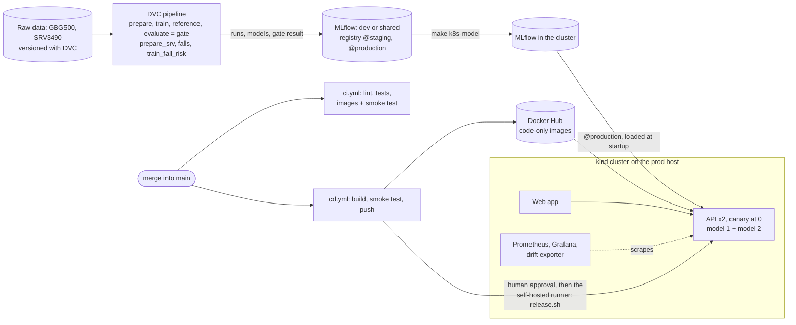

# ADR 000 - The project in one read: what we built, and why

**Status:** reference, 25/11/2026. **Read this first** to understand the whole project before the oral.

Each decision below follows the same pattern: **context** (the problem), **decision**, **why**, **rejected**
(the alternatives we considered), **consequences**, **evidence**. Where a detailed record exists (ADRs 001–011),
this file summarises it and links to it. The decisions taken on 22–24/11 had no record yet; they are written in
full here (marked ✚).

Other documents: [PLAN.md](../PLAN.md) has the tasks and their status, [JOURNAL.md](../JOURNAL.md) the
day-by-day story, [how_to_use.md](../how_to_use.md) every command, and the [README](../../README.md) the summary
for the graders.

---

## 0. In one minute

- **Input:** the motion sensors of one ride, 10 readings per second: acceleration `ax, ay, az` (m/s²) and
  rotation `rx, ry, rz` (deg/s).
- **Model 1, the ride type** (what the MLOps brief asks for): which of 5 categories the whole ride belongs to:
  Safe, Safe overall, Bad weather, Tandem or Reckless.
  - It is a 1D CNN (PyTorch), trained on **GBG500**.
  - Golden macro-F1 **0.511**, against **0.20** for random guessing.
- **Model 2, the fall risk** (our use of the second dataset): for every 10 s of the ride, how much that moment
  looks like the minute before a fall.
  - It is a logistic regression, trained on **SRV3490**.
  - Held-out paired AUC **0.888**.
- **The system:**
  - a DVC pipeline;
  - MLflow, for tracking, the quality gate and the registry (`@staging`, `@production`);
  - code-only Docker images on Docker Hub;
  - a kind cluster on one laptop, released by GitHub Actions after a human approval, with automatic rollback;
  - a FastAPI API, a Streamlit web app, and Prometheus with Grafana for monitoring.
- **One project, two courses:** MLOps and Model Deployment, and Advanced Cloud AI Infrastructure. The Cloud
  part lives in `ai-infrastructure/` (section 8).

## 1. The chain, end to end

Code and models are released separately:

| What changes | How it reaches production | What stays the same |
|---|---|---|
| **Code** (API, web app) | Merge into `main` → `cd.yml` builds and pushes the images → a reviewer approves → the self-hosted runner releases them, runs the smoke test, rolls back on failure | The models |
| **A model** | Training registers it as `@staging` → a human moves `@production` (`make promote`) → `make k8s-model` copies it into the cluster's MLflow and restarts the API | The images |

## 2. Timeline

| Date | What happened |
|---|---|
| 16/11 | Plan ([PLAN.md](../PLAN.md)), repository skeleton, raw data in DVC, CI |
| 17–18/11 | Cleaning, frozen golden split, baseline E0, quality gate, registry, API |
| 19/11 | CNN experiments E1–E3; E3 registered as v2 and put in production; web app; Docker images; kind cluster |
| 20/11 | Teacher's briefing: use all the data, look at falls. Project framing, ADRs 005–009 |
| 21/11 | Two-model design (ADR 001) and its consequences (ADRs 002, 003, 004, 010); shared MLflow on GCP (ADR 011); model 2 trained; live window endpoint |
| 22/11 | `fall-risk` v1 registered; drift reference, offline drift report, drift scenarios; `train.yml` and `drift.yml` |
| 23/11 | Monitoring on kind; code-only images that load both models from MLflow; copying models into the cluster |
| 24/11 | CD with approval and rollback in use; README for the graders; web app with both models; golden example rides in production; E5 top-k study |
| 25/11 | Submission, before 20:00 |
| 26/11 | Oral: 10 min, then 10 min of questions |

---

## 3. Problem and data

### D1 - The task: classify a whole ride into 5 categories, and beat random

- **Context:**
  - The brief asks for a deep learning model that classifies rides into 5 categories and does better than random.
  - Accuracy is not the main grading point. A coherent, automated, documented system is.
- **Decision:** the unit of prediction is **the ride**.
  - The main metric is **macro-F1**: each category counts equally.
  - Two references are measured on the same rides: random guessing (≈ 0.20) and always answering "Safe" (≈ 0.18).
- **Why macro-F1:** answering "Safe" every time already gets 83 % accuracy, so accuracy says nothing here.
  Macro-F1 punishes a model that ignores the rare categories.
- **Consequences:**
  - The API also returns a `reckless_score` and an `is_reckless` flag. Reckless is the category the course data
    calls "the class we aim to detect".
  - The flag is on when the ride is predicted Reckless, or when `reckless_score ≥ 0.5`. That 0.5 is not tuned: out
    of fold, every threshold from 0.3 to 0.7 flags the same rides.
- **Evidence:** [PLAN.md](../PLAN.md) DEC-1, §6.3–6.4.

### D2 - Use both datasets, as two separate models ([ADR 001](001-two-models-ride-type-and-fall-risk.md))

- **Context:** the two datasets answer different questions, and no ride appears in both.

  | Dataset | Rides | Labels |
  |---|---|---|
  | GBG500 | 500, one city, 3–8 min each, 1.5 M readings | **One category per ride** (the whole ride, not its moments): Safe 416, Safe overall 38, Bad weather 22, Tandem 18, Reckless 6. **No fall information.** |
  | SRV3490 | 3,490, 8 cities, 16.9 M readings | **No category.** A `topple` column marks **the moment of a fall**: 698 rides with a fall, each with 4 comparison rides without one (same city) |

- **History:**
  - 16/11: SRV3490 is set aside (DEC-2).
  - 20/11: the teacher's briefing asks us to use all the data and to look at falls.
  - 21/11 morning: one label-free "danger score" for everything. Replaced the same day, because it mixed two use
    cases and tuned one on the other's metric.
  - 21/11 evening: two models.
- **Decision:**
  - **Model 1, ride type:** E3 on GBG500. A category describes a whole ride.
  - **Model 2, fall risk:** a short sliding window on SRV3490. A fall risk describes a moment.
  - Each model has its own pipeline, gate and registry entry. Both are served by one API (D12).
- **Rejected:**
  - One model for both: a whole-ride label and a momentary risk need different aggregations and evaluations.
  - Detecting a fall after it happens: useless, since the rider already knows.
- **Consequences:**
  - The GBG500 rides in the web app have **no true fall** to compare model 2 with. Model 2 can only be checked on
    held-out SRV3490 rides (D9).
  - The true category is a single block for the whole ride, never one per window.
- **Evidence:** [PROJECT_FRAMING.md](../PROJECT_FRAMING.md), [USE_CASE.md](../USE_CASE.md).

### D3 - 100 golden rides frozen before any training; 5-fold cross-validation on the 400 others

- **Context:** with 500 labelled rides, scoring a model on the rides used to choose it flatters it.
- **Decision:**
  - The `prepare` stage sets aside 100 **golden** rides once, stratified: Safe 83, Safe overall 8, Bad weather 4,
    Tandem 4, Reckless 1.
  - They are used only for the final score and the quality gate.
  - Models are compared on 5-fold cross-validation over the 400 others, at ride level: all windows of a ride stay
    in one fold.
  - The list is in `data/processed/splits.csv`, committed to git, so any change would show in a pull request.
- **Consequences:**
  - The golden set holds **a single Reckless ride**: the golden Reckless recall (1.00) proves nothing.
  - CV scores vary by about ±0.07 between folds: differences smaller than that are noise.
- **Evidence:** `params.yaml` `data`, `dvc.yaml` stage `prepare`.

### D4 - Data versioned with DVC, never in git nor in an image

- **Decision:**
  - The raw files are tracked with `dvc add`: git keeps only the `data/raw/*.dvc` pointers (md5 of the exact
    version).
  - Contents go to a remote: the local S3 of each laptop's dev stack, or the team's private GCS bucket
    (`make shared-data-pull`).
  - Every MLflow run records `data_md5`.
- **Why:** reproducibility (lab 1). Also, the course data must not be published: the repository is public.
- **Evidence:** [ADR 011](011-shared-mlflow-and-dvc-on-gcp.md), how_to_use §4.

### D5 - Cleaning shared by training and serving; SRV3490 rotation converted with 180/π ([ADR 003](003-srv3490-rotation-unit-conversion.md))

- **Decision:**
  - **One cleaning function**, used by training, the MLflow model and the API: sort, drop duplicate timestamps,
    interpolate the gaps. 0.67 % of GBG500 readings are missing, in gaps of 1–19 readings.
  - SRV3490 rotation is in rad/s (measured ratio ≈ 60). It is converted with the exact factor 57.2958, in one
    place (`prepare_srv`).
- **Why:**
  - The model is a pyfunc that contains its own preprocessing, so training and serving cannot diverge.
  - A unit change is a physical constant, not a parameter to fit.
- **Consequences:** a sender that forgets the conversion is our "sensor unit bug" drift scenario. The answer is
  to fix the sender, not to retrain (D18).

---

## 4. Model 1: ride type

### D6 - Baseline first, then a CNN on 30 s windows; E3 in production ([ADR 002](002-window-lengths.md))

- **Context:** the brief asks for deep learning, but 400 training rides are few for it.
- **Decision:**
  1. **E0, the baseline:** about 170 statistics per ride and a logistic regression. It went through the whole
     chain first (pipeline, MLflow, gate, image, cluster), so the system worked from day 4 whatever happened to
     the CNN.
  2. **The CNN:**
     - Each ride is cut into **30 s windows (300 readings), one every 15 s**: 11 to 30 windows per ride, about
       7,500 training windows in all.
     - Three convolution blocks with 32, 64 and 64 filters (kernel 0.7 s), then dropout 0.3.
     - Augmentation: ±10 % scaling and noise.
     - Each window is classified on its own. **The ride gets the mean of its window probabilities.**

  | Experiment | CV macro-F1 | Golden macro-F1 | Gate | Lesson |
  |---|---|---|---|---|
  | E0 baseline (v1) | 0.373 ± 0.062 | 0.477 | passed | The bar to beat |
  | E1 CNN, balanced class weights, 20 epochs | 0.282 | 0.177 | failed | A Reckless window weighed 66 times a Safe one: it over-predicted the rare categories |
  | E2 CNN, square-root class weights, 20 epochs | 0.312 | 0.286 | failed | Overfits |
  | **E3 CNN, square-root class weights, 10 epochs (v2, production)** | **0.357 ± 0.071** | **0.511** | **passed** | |

- **Why E3 is in production:**
  - It meets the brief's deep learning requirement, passes the gate, and does at least as well as v1 on golden
    (the registration rule, D10).
  - It is **not** better than the baseline: CV favours the baseline, golden favours the CNN, and both
    differences are within the noise. Say so if asked.
  - E3 was chosen on CV, not on golden, so the golden set stayed unbiased.
- **Weak labels:**
  - Every window inherits its ride's label. A "Reckless" ride is not reckless every second, so many training
    windows are mislabelled.
  - This is the main limit of model 1, more than the architecture.
- **Golden recall per category:** Safe 0.75, Safe overall 0.63, Bad weather 0.00, Tandem 0.75, Reckless 1.00
  (Reckless rests on one ride).
- **Evidence:**
  - [PLAN.md](../PLAN.md) §6.5 and DEC-4;
  - MLflow experiment `ride-classifier`;
  - figures F09 (golden confusion matrix) and F10 (golden macro-F1 against the gate).

### D7 - A ride's category is the plain mean of its windows; top-k studied and not adopted (✚ E5, issue #31)

- **Context:**
  - Because the ride's answer is a mean, it can be read **as the ride goes**: after each window, the category
    so far. That is the timeline the API returns and the web app plots.
  - The last point of that timeline is always the final answer.
  - A mean can dilute a short episode: a few reckless minutes inside a calm ride.
- **Decision:** keep the **plain mean**.
  - We tested whether a top-k mean does better: for each category, the mean of its k highest window
    probabilities.
  - The study was **pre-registered**: 9 candidates and a decision rule written before any run (+0.03 CV
    macro-F1, and better on at least 4 of 5 folds).
  - It ran on E3's own folds, using out-of-fold window probabilities. The golden rides were not read.
- **Result:**
  - The mean reproduces E3 exactly (0.357).
  - The best candidate, top-3, scores 0.353 and is better on only 3 folds.
  - No candidate recovers the missed Reckless rides: their windows are not strongly Reckless anywhere, so there
    is no diluted episode to recover.
- **Example:** on the golden "Safe overall" example ride, Tandem wins 12 of 22 windows. Even top-k would answer
  Tandem, although the chart shows a strong "Safe overall" start.
- **Consequences:**
  - The limit is the window scores themselves (weak labels), not the way they are combined.
  - Phase B (a new model version scored on golden) was not started.
- **Evidence:** [experiments/topk_study.md](../experiments/topk_study.md), MLflow run `E5-topk-study`.

### D8 - The quality gate is a pipeline stage that fails

- **Decision:** the `evaluate` stage scores the final model once on the golden rides. **It exits with an error
  (the pipeline stops) unless both of these hold:**
  - golden macro-F1 ≥ 0.30;
  - it beats both references, random guessing and always "Safe".

  It also writes macro-F1 against elapsed time (30 s, 1 min, 2 min, 5 min, 10 min, whole ride) and tags the
  training run `gate=passed` or `gate=failed`.
- **Why:**
  - 0.30 is 1.5 times random: a floor that catches a broken model, not a target.
  - Comparing with the production model is a different question, checked at registration (D10).
- **Evidence:** `params.yaml` `evaluate.gate`, [how_to_use.md](../how_to_use.md) §7.

---

## 5. Model 2: fall risk

### D9 - Logistic regression on 10 s windows, with a 5 s anti-leakage gap ([ADR 002](002-window-lengths.md), [ADR 004](004-fall-risk-anti-leakage-gap.md))

- **Decision:**
  - **Windows:** 10 s, one every 5 s. Each is summarised with the baseline's statistics, then scored by a
    logistic regression.
  - **Positive windows:** those ending in the 60 s before the gap, on a ride with a fall.
  - **Negative windows:** the **same moments** of the 4 comparison rides of the same fall group (same city).
  - **Gap:** training and evaluation stop **5 s before** the first `topple` reading, so the model never sees the
    start of the fall. A **10 s gap is the sanity check**: if the result collapsed with a larger gap, the model
    would be reading the fall itself.
  - **Split:** fall groups split once, 70 % development and 30 % held-out, per city. A group is never split.
  - **Gate:** held-out paired AUC ≥ 0.55.
- **Why 10 s:**
  - Measured: separation grows as windows shrink (paired AUC 0.72 at 60 s, 0.75 at 30 s, 0.84 at 15 s,
    0.88 at 10 s).
  - 5 s scored 0.96, which looked like the fall leaking in, so we did not keep it.
- **Results** (held-out, registered `fall-risk` v1):

  | | 5 s gap | 10 s gap (check) |
  |---|---|---|
  | Paired AUC: is the pre-fall risk above its comparison rides? | **0.888** | 0.756 |
  | Window AUC | 0.712 | 0.691 |

- **Limits, to state honestly:**
  - It measures a risk **associated with** falls (a pothole can cause one), not recklessness.
  - SRV3490 has 20 % falls by design, so its alert rates are not real-world rates.
  - The alert threshold of 0.6 is **not calibrated**. On GBG500 rides, about 14 % of windows cross it. It is a
    useful signal, not yet a usable alarm.
  - v1 does not use model 1's output as a feature: ADR 001 allows it, but we did not do it.
- **Evidence:** `params.yaml` `fall_risk`, `pipeline/train_fall_risk.py`, figure F49,
  `notebooks/07_fall_risk.ipynb`.

---

## 6. Tracking, registry, reproducibility

### D10 - Every run in MLflow; registration has rules; promotion is human

- **Decision:**
  - **Every run logs:**
    - all of `params.yaml`;
    - the tags `git_commit`, `git_dirty`, `data_md5`, `model_type`, `experiment_id`;
    - CV and golden metrics;
    - confusion matrices and out-of-fold predictions.
  - Models are pyfunc models with a signature and input example.
  - Artifacts go to S3-compatible storage: that is how we meet "model stored on S3".
  - **Aliases, not stages** (stages are deprecated): `@staging` = the newest version that passed the gate;
    `@production` = what runs.
  - **`register.py` refuses a run** unless all three hold:
    - its code was committed (`git_dirty=False`), so it can be rebuilt;
    - it passed the gate;
    - its golden score is at least the current `@production`'s.

    It says which rule failed.
  - **Promotion to `@production` is a human step** (`make promote`).
- **Registry today:**
  - `ride-classifier` v1 = E0 baseline, kept as the reference.
  - `ride-classifier` v2 = E3, `@staging` and `@production`.
  - `fall-risk` v1, `@production`.
- **Reproducibility:**
  - `repro_check.py` checks that the code and the data match a run, reruns the pipeline in a temporary folder,
    and compares every score within 1e-6.
  - E3 was retrained from a clean commit and reproduced exactly.
- **Evidence:** [PLAN.md](../PLAN.md) §8, `src/ride_classifier/registry/`.

### D11 - Three MLflow servers, one history ✚ (and [ADR 011](011-shared-mlflow-and-dvc-on-gcp.md))

- **Context:** experiments happen on laptops, the team needs to share them, and production must not depend on a
  laptop's dev stack nor on GCP being reachable.
- **Decision:** three servers with the same MLflow version (3.17.2):

  | Server | Where | Role |
  |---|---|---|
  | Dev | Each laptop, `make dev-up` (Postgres + SeaweedFS), :5000 | Experiments |
  | Shared | Cloud Run, private, through `make shared-mlflow` on :5001; files in a private GCS bucket | The team's runs and registered models |
  | Cluster | Inside kind (Postgres + SeaweedFS), :8082 | What production loads |

- **`make k8s-model` (`registry/mirror.py`)** copies registered versions into the cluster's MLflow, with their
  runs, files and aliases. Then it restarts the API.
  - It **keeps the version numbers**: v2 stays v2 everywhere.
  - It matches runs across servers by their original run id, and copies only new files, so it can be run again.
  - It checks the registration rules again, and refuses to overwrite a version that came from elsewhere.
  - It copies model 1, the drift reference that comes with it, and model 2.
- **Why not point production at the shared server:** the cluster would stop working when the laptop is offline
  or Google credentials expire. Production holds its own copy.
- **Evidence:** `src/ride_classifier/registry/mirror.py`, `tests/unit/registry/test_mirror.py`, how_to_use §12.

---

## 7. Serving and production

### D12 - One API serving both models ([ADR 010](010-one-service-two-models.md), [ADR 005](005-stateless-live-api.md))

- **Decision:** one FastAPI service loads both models at startup and serves them side by side.

  | Endpoint | What it does |
  |---|---|
  | `POST /v1/predict` | A whole ride as JSON, one array per channel. Model 1's category, probabilities, Reckless flag and timeline; model 2's risk per window, **marked retrospective** |
  | `POST /v1/predict/file` | The same, from a CSV or parquet upload |
  | `POST /v1/predict/window` | **Live:** one 30 s window plus the state the client sent back. Returns the category so far, model 2's risk on the last 10 s, and the new state |
  | `POST /v1/feedback` | The true label, received later (monitoring layer 4) |
  | `GET /health` | 200 with both model versions; **503 if model 1 is missing** (the Kubernetes probes use it) |
  | `GET /metrics`, `/docs` | Prometheus metrics; Swagger |

- **Rules:**
  - A strict contract: unknown fields are refused.
  - Each ride must have 300 to 20,000 readings, within physical bounds, with no NaN.
  - Error codes: 422 = the caller's mistake, 500 = ours (no stack trace), 503 = no model.
  - Every answer carries `X-Request-ID` and `X-Process-Time-Ms`.
  - Without model 2, the API answers with model 1 alone (degraded mode). Never the reverse.
- **Why a stateless live endpoint** (ADR 005):
  - The client carries the running sums (6 numbers), so any replica can answer any window.
  - There are no sessions to lose on a restart, and no sticky routing.
- **Measured on the cluster:**
  - Live window: median 128 ms, p95 184 ms, within the 200 ms budget.
  - Whole ride: 2.0 s for 4 min, 3.7 s for 7.5 min. It computes the full timeline of both models on 1 CPU.

### D13 - Images carry code only; models come from MLflow at startup ✚ ([ADR 007](007-public-images-without-model-or-data.md))

- **Context:**
  - The first images (19/11) had the model baked in, as in the labs.
  - The repository and Docker Hub are public, and the course data and models trained on it must not be
    published.
- **Decision:**
  - The images hold **code only**.
  - At startup the API reads `MODEL_URI=models:/ride-classifier@production` and
    `FALL_RISK_URI=models:/fall-risk@production` from `MLFLOW_TRACKING_URI`.
  - **The alias is resolved to an exact version first**, so `/health` reports what really runs.
  - The drift reference is downloaded from **model 1's own training run**, so it always matches the model
    loaded.
  - Image tag = the 7-character commit. The old tags that held the model were deleted from Docker Hub.
- **Rejected:**
  - Private Docker Hub repositories: the free plan allows one.
  - A model inside the image: it would publish the model.
- **Consequences:**
  - **A new model needs no new image:** move `@production`, run `make k8s-model`.
  - The pods need MLflow at startup. The smoke test and the startup probe cover that.
  - CI tests the images with tiny test models that it mounts.
- **Evidence:** `src/ride_classifier/api/main.py` (`resolve_model`, `load_fall_model`, `load_drift_reference`),
  `docker/api/Dockerfile`.

### D14 - Production is a kind cluster on one laptop ✚ (PLAN DEC-8)

- **Context:** the brief accepts kind, Minikube or Docker Desktop; the course's lab 5 uses kind.
- **Decision:**
  - The kind cluster `ride-mlops` runs on the "prod host" laptop, namespace `ride-prod`.
  - Ports, fixed when the cluster is created: API 8080, web app 8081, MLflow 8082, Grafana 8083, Prometheus 8084,
    S3 8085–8086.
  - It contains:
    - **S3 storage and Postgres**, as StatefulSets with volumes, plus a Job that creates the buckets;
    - **MLflow**;
    - **the API**: `ride-api-v1`, 2 replicas, with startup, readiness and liveness probes on `/health`. Each pod
      requests 250m CPU and 512 MiB, limited to 1 CPU and 1 GiB;
    - **a canary deployment** at 0 replicas, sharing the API's Service, ready for a canary or a drill;
    - **the web app**;
    - **monitoring** (D17).
  - Configuration goes in a ConfigMap (model URIs, thresholds). Secrets are created from environment variables by
    `k8s/secrets.sh` and never committed.
  - The image tags are pinned in one place, `k8s/kustomization.yaml`, and everything is applied with
    `kubectl apply -k k8s/`.
- **Fixes worth knowing:**
  - MLflow's background job processes are turned off: they took about 1.8 GB and got the pod killed for memory.
  - The example rides are applied server-side: a ride is too large for the usual annotation limit of
    `kubectl apply`.
  - Everything running takes 3.8 GB of memory.
- **Limits:**
  - One laptop: the cluster stops with it.
  - A backup host can redeploy from Docker Hub and the manifests.
- **Evidence:** `k8s/`, how_to_use §12.

### D15 - CI tests everything and never deploys; CD deploys after a human approval, with automatic rollback ✚

- **CI** (`ci.yml`, every push and pull request, GitHub's machines):
  - ruff and the **208 tests**;
  - both images built and started;
  - a **container smoke test** with test models: `/health`, then a prediction with both models.
- **CD** (`cd.yml`, every merge into `main` that touches code, images or `k8s/`):
  1. **images** job, on GitHub's machines: build both images, run the same smoke test, push `<commit>` and
     `latest`.
  2. **Approval:** the `deploy` job waits in the GitHub environment `production` until a reviewer approves.
  3. **deploy** job, on the **self-hosted runner** on the prod host (label `prod-host`). It runs `k8s/release.sh`:
     - set the tag in `kustomization.yaml`;
     - `kubectl apply`, then wait for the rollout;
     - smoke test on the cluster;
     - **if anything fails, re-apply the previous version.**
  4. The bot commits the released tag to `main`, so git always says what runs.
- **Why a self-hosted runner:**
  - GitHub's machines cannot reach a cluster on a laptop.
  - It only runs on `main` and on manual triggers, **never on pull requests**, so code from a fork can never run
    on the prod host.
- **Measured:**
  - Images take 3 min, the release 4 min after approval.
  - A release with a tag that doesn't exist **rolled back by itself**. The API answered 200 to every check
    during the attempt (30 checks over 2 min).
- **Windows runner pitfalls** (fixed):
  - `bash` was WSL's, not Git Bash;
  - `uv` was not on the runner's PATH;
  - PowerShell blocked scripts;
  - a tag like `7111e57` is a number in YAML, so tags are quoted.
- **Evidence:** `.github/workflows/`, `k8s/release.sh`, screenshots `cd-approval.png` and `cd-run.png`.

### D16 - The web app is a client of the API, for live inference only ✚

- **Decision:**
  - The Streamlit app holds no model.
  - **Choosing a ride:** pick one of the 5 golden example rides (one per category) or upload a file; it plots the
    6 signals.
  - **After "Classify",** two blocks side by side:
    - model 1: the category, its probabilities and the Reckless flag;
    - model 2: the riskiest moment, the number of alert moments, the threshold, and an honest note.
  - **"Along the ride"**, on **one shared time axis**:
    - the probability of each category so far;
    - two strips: model 1's answer so far, and the true category (example rides only);
    - model 2's risk, with the 0.6 threshold and the alert moments.
  - **Example rides in production:** generated locally (`make webapp-examples`) and put into the cluster as
    ConfigMaps (`make k8s-examples`). Never in git, never in an image (D13).
- **Rejected:**
  - Tabs with the models' performance: that is MLflow's job. One tool per job: MLflow for model quality, the web
    app for live inference, Grafana for production health.
  - A true-fall overlay: GBG500 has no fall labels (D2).
  - A live replay, window by window: an extra, not done.
- **Evidence:** `webapp/`, screenshots `webapp-1.png` to `webapp-3.png`.

---

## 8. Monitoring, drift, retraining, and the Cloud course

### D17 - Four monitoring layers; live drift alerts off until calibrated

- **Decision:** the four layers of the course (S6), all exposed as Prometheus metrics, with an 11-panel Grafana
  dashboard (on compose and on kind):

  | Layer | Examples |
  |---|---|
  | Infrastructure | Requests and errors per endpoint, latency histogram, pod restarts |
  | Inputs | 8 window features in histograms whose bins come from the drift reference; a **drift exporter** computes the rolling PSI per feature |
  | Predictions | Predictions per category, Reckless flags, fall-risk histogram and alerts, the model version |
  | Outcomes | `feedback_total` from `/v1/feedback` |

- **Live drift alerts are disabled** (`drift.live_alerts_enabled: false`):
  - In a calibration on normal training rides, **49 of 49** one-ride samples had a PSI ≥ 0.25: the alert would
    fire on normal traffic.
  - The PSI stays visible, but alerting waits for proper ride-level sampling.
  - The Prometheus alert rules have no notification channel.
- **Drift scenarios**, built from real rides: normal, riskier mix, an unseen city, the unit bug. The offline drift
  job exits with 0 (normal), 3 (retraining recommended) or 1 (error).
- **Evidence:** `monitoring/`, `k8s/monitoring/`, `src/ride_classifier/drift/`, [runbooks.md](../runbooks.md).

### D18 - Retraining is gated and approved by a human ([ADR 008](008-hybrid-retraining-with-human-approval.md))

- **Decision:**
  - `train.yml` (weekly or manual, with a reason) retrains model 1. The gate decides `@staging`, and a human
    promotes.
  - `drift.yml` writes a daily drift report.
  - The runbook separates a sender bug (rotation off by a factor near 57: fix the sender, don't retrain) from a
    real change in the riders (retrain).
- **Status:** both workflows are **drafts, not yet run on a runner**. They target any self-hosted runner, so they
  currently land on the prod host's CD runner and fail there. Vincent is fixing that.
- **Evidence:** [retraining-policy.md](../retraining-policy.md).

### D19 - The Cloud course on the same project ([ADR 006](006-gcp-instead-of-aws.md))

- **Context:** the school gives us GCP, not AWS. GPUs are available only as Vertex AI jobs in SPOT mode.
- **The question:** compare running our workload on **local CPU** with **Google Cloud CPU, GPU and TPU**, on
  speed and on price, and pick the best for us. Vincent leads this part, in `ai-infrastructure/` and issues #3–#8
  and #45.
- **First measurement** (laptop CPU, network alone, E3):
  - about 1 ms per window one at a time;
  - about 10,000 windows/s in batches of 128;
  - about 270 MB of memory.
- **Evidence:** `ai-infrastructure/benchmarks/` (on Vincent's branch until merged), the README's
  "AI infrastructure" section.

---

## 9. How we work

- **Plan first:** [PLAN.md](../PLAN.md) was written and approved before any code. Each task is updated there
  before it is coded.
- **Branches and pull requests:**
  - one branch per piece of work;
  - pull requests merged with CI green;
  - conventional commits (`feat:`, `fix:`, `docs:`…).
- **Decisions are written down:** ADRs in this folder; [JOURNAL.md](../JOURNAL.md) for the story, mistakes
  included.
- **Experiments are pre-registered:** the window study and E5 have a question and a decision rule written before
  the run.
- **Secrets:** never in the repository nor in an image. Docker Hub credentials are GitHub secrets; cluster
  secrets come from environment variables.

## 10. Numbers to know

| What | Value |
|---|---|
| Labelled rides (GBG500) | 500: Safe 416, Safe overall 38, Bad weather 22, Tandem 18, Reckless 6 |
| Golden rides | 100 (83 / 8 / 4 / 4 / 1), frozen before training |
| Model 1 (E3, v2) | Golden macro-F1 **0.511**, CV 0.357 ± 0.071; random 0.20, always "Safe" 0.18; baseline v1 0.477 |
| Model 1 windows | 30 s every 15 s; about 7,500 training windows |
| Model 2 (`fall-risk` v1) | Held-out paired AUC **0.888** (5 s gap) / 0.756 (10 s check) |
| Model 2 windows | 10 s every 5 s; alert at 0.6 (not calibrated) |
| Quality gate | Golden macro-F1 ≥ 0.30 and above both references |
| Live latency on kind | Median 128 ms, p95 184 ms (budget 200 ms) |
| CD | Images 3 min, release 4 min; failed release rolled back with no downtime |
| Tests | 208 |
| Cluster memory | 3.8 GB with everything running |

## 11. Limits and open items

- **Little labelled data:** 6 Reckless rides, 1 in golden. Weak labels on windows.
- **Bad weather is never found on golden** (recall 0.00).
- **Model 2's threshold is not calibrated**, and it comes from another dataset and other cities.
- **Whole-ride predictions are slow** (2–4 s). The live endpoint, which the latency budget is about, meets it.
- **The prod host is one laptop.** The CD runner works only while `run.cmd` is open on it.
- **Drift thresholds are provisional;** live drift alerts are off.
- **Not done:**
  - the load test of 1 vs 3 replicas (TST-2);
  - the timed canary and rollback drill (OPS-3);
  - the CI integration job with the compose stack (INF-3);
  - a feature store (optional);
  - running `train.yml` and `drift.yml` on a runner.

## 12. Where things are

| Topic | Where |
|---|---|
| Pipeline | `dvc.yaml`, `params.yaml`, `src/ride_classifier/pipeline/` |
| Models | `src/ride_classifier/models/` (`cnn.py`, `baseline.py`, `fall_risk.py`, `pyfunc.py`, `timeline.py`) |
| MLflow: tracking, registry, copy to the cluster | `src/ride_classifier/registry/` |
| API | `src/ride_classifier/api/` |
| Web app | `webapp/` |
| Drift and monitoring | `src/ride_classifier/drift/`, `monitoring/`, `k8s/monitoring/` |
| Images | `docker/` |
| Cluster and release | `k8s/` (`kustomization.yaml`, `release.sh`, `secrets.sh`, `examples.sh`) |
| Workflows | `.github/workflows/` (`ci.yml`, `cd.yml`, `train.yml`, `drift.yml`) |
| Tests | `tests/unit/` (mirrors `src/`), `tests/integration/` (smoke tests) |
| Experiments | `docs/experiments/`, `src/ride_classifier/experiments/` |
| Figures and screenshots | `assets/figures/`, `assets/screenshots/` |
| Cloud course | `ai-infrastructure/` |
