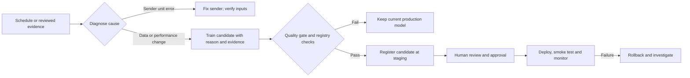

# Retraining policy

The policy separates detecting a problem, producing a candidate and putting a candidate into production. The
workflow files are implementation drafts: the self-hosted runner and the full sequence have not yet been tested.

## Triggers and investigation

- **Schedule:** a weekly run is planned to test the process. With unchanged data and code, this reproduces a
  candidate and is not evidence of improvement. It must not automatically deploy.
- **Input drift:** inspect the affected features, units, sampling and reference version. The thresholds are
  provisional. In a local calibration resampling the reference's training population, 49/49 one-ride samples with
  at least 20 windows had a maximum feature PSI >= 0.25; these overlapping samples are not an independent
  production false-alarm estimate. The monitor's minimum of 20 windows therefore does not guarantee reliable
  alerts. A rad/s versus deg/s sender error is repaired upstream, not learned by the model.
- **Prediction drift:** compare one prediction per ride with a compatible reference; repeated windows from a
  ride are dependent. Check population and sample size before interpreting an approximate chi-square p-value.
- **Performance:** assess enough delayed, representative, quality-checked labels; biased voluntary feedback is
  not a representative evaluation. Investigate macro-F1 and the categories behind the change.
- **Manual:** record why the candidate is being produced. Drift and performance dispatches require an evidence
  reference. Neither a statistical alert nor a schedule alone justifies promotion.

## Training and staging

The draft `.github/workflows/train.yml` runs on a self-hosted runner. It requires an explicit reachable
`MLFLOW_TRACKING_URI` and `COURSE_DVC_CREDENTIALS` pointing to the isolated school-account credential file.
It pulls the committed training and golden outputs from the shared DVC remote, forces a new model-1 training run,
records the trigger and workflow URL on that run, evaluates the candidate, and only then attempts registration
at `@staging`. The run must be new, finished, from the checked-out commit and clean. Registration independently
requires a passing quality gate and rejects regression against the registered production score when present.

This workflow does **not** create a new dataset or automatically incorporate incoming labels. The runner's DVC
data must match the checked-out pipeline version. Any intentional data update, split and review must precede the
run; the frozen golden split is not a training source. The workflow does not retrain model 2. Avoid treating the
same golden score as an unlimited tuning target when deciding on repeated candidates.

## Production and recovery

`@staging` is a candidate, not a deployed model. The planned CD workflow must build the code-only image, require
approval in the `production` environment, deploy the selected version, verify it with a smoke test, and update
`@production` only after success. On failure it must roll back and report the outcome. These steps remain to be
implemented and exercised; the existence of a staging version does not demonstrate deployment or rollback.

Keep the workflow run, trigger evidence, MLflow run and model version linked. Before approving, check the cause,
data provenance, gate results and intended version. See [runbooks](runbooks.md) for the incident diagnosis.
